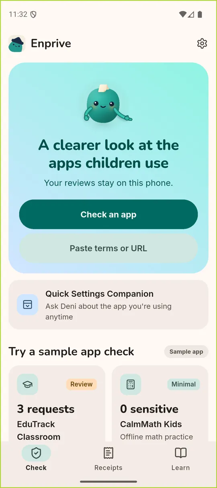
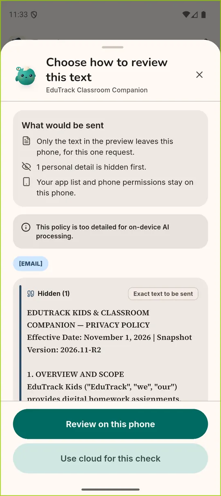
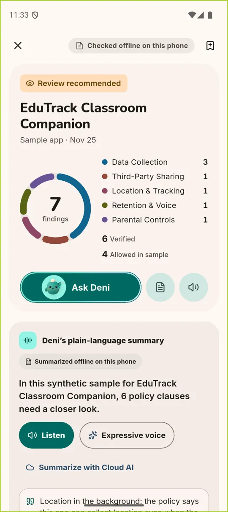
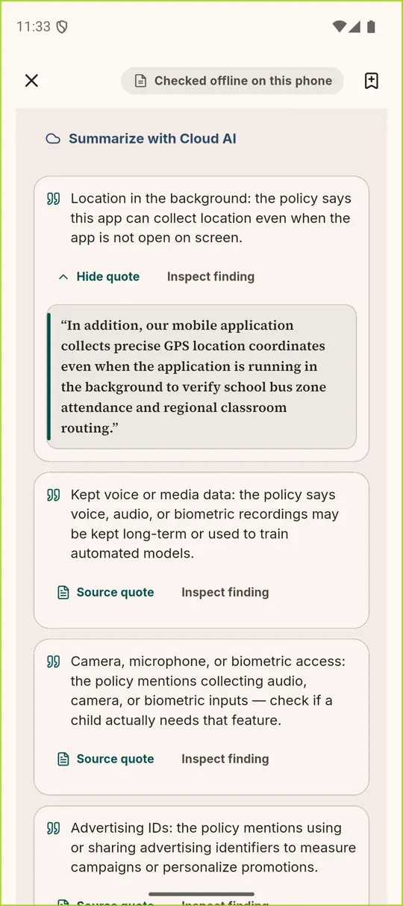
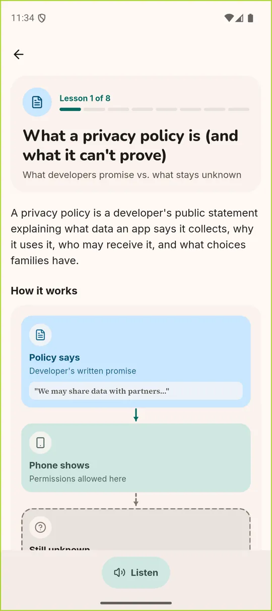
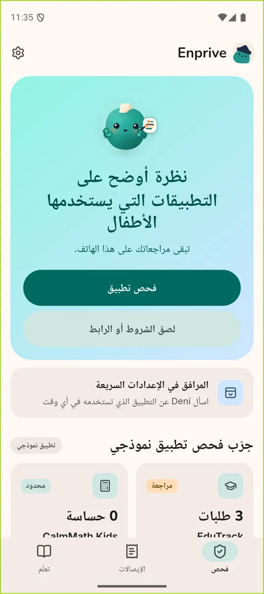
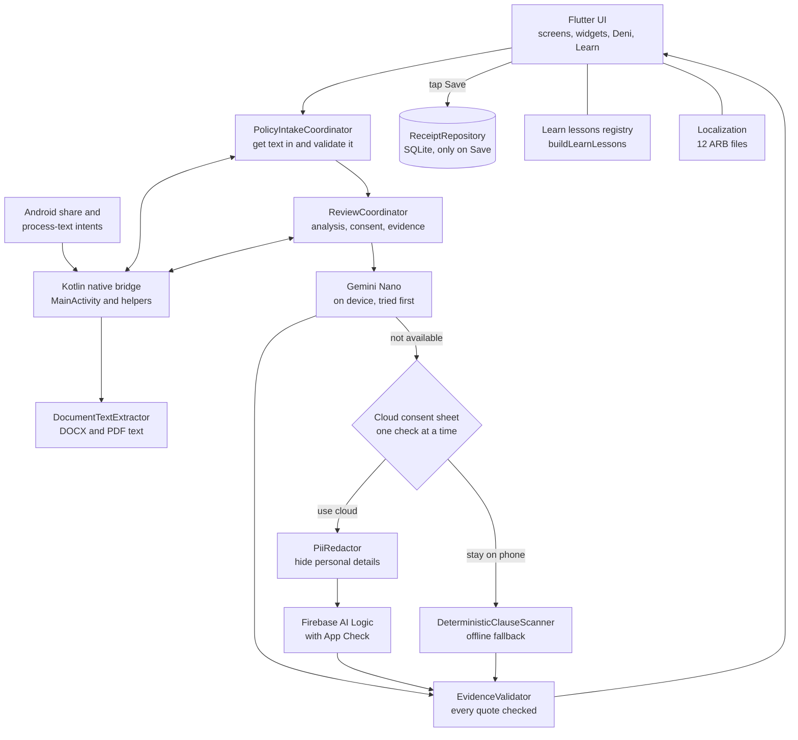

# Enprive

**Understand what an app's privacy policy says, and compare it with what your phone shows, without handing over your app list.**

Privacy policies are long, full of legal words, and hard to read on a phone. Yet children use new learning apps, games, and classroom tools every week. Parents and teachers are often left guessing what an app asks to collect or share.

Enprive is a calm Android privacy companion built for **Google #BuildHybridAI 2026**. It reads a policy with you, highlights the exact sentences that matter, puts them beside the permissions Android reports on your phone, and tells you plainly what is still unknown. Deni, a friendly pebble-shaped helper, explains things in plain words.

<p align="center">
  
</p>

---

## See it

All screenshots come from the Android emulator and use the built-in **sample apps** (EduTrack Classroom and CalmMath Kids). No real apps or personal data are shown.

<table>
  <tr>
    <td align="center" width="33%"><br><b>1. Start a check</b><br>Pick an app or paste a policy.</td>
    <td align="center" width="33%"><br><b>2. You choose how</b><br>Stay on your phone, or allow the cloud for this one check.</td>
    <td align="center" width="33%"><br><b>3. See the result</b><br>Findings by topic, and Deni's summary.</td>
  </tr>
  <tr>
    <td align="center" width="33%"><br><b>4. Check the evidence</b><br>Every finding can show the exact quote.</td>
    <td align="center" width="33%"><br><b>5. Learn the basics</b><br>Eight short offline lessons with diagrams.</td>
    <td align="center" width="33%"><br><b>6. Your language</b><br>12 languages, including right-to-left Arabic.</td>
  </tr>
</table>

---

## Who it is for

- **Parents and guardians** checking an app before or after a child uses it at home.
- **Teachers and school staff** doing a quick first look at classroom and learning apps.
- **Children and young learners** exploring simple, offline privacy habits alongside an adult.

---

## How a check works

1. **Choose what to check.** Pick an installed app, paste policy text, enter a public policy link, import a PDF, TXT, or DOCX file, or share text, a link, or a file to Enprive from another Android app.
2. **Enprive reads it.** It first tries the AI that lives on your phone (Gemini Nano). If that is not available or the policy is too long, it asks you what to do.
3. **You decide.** The consent sheet shows the exact text that would leave your phone, with personal details such as emails and phone numbers already hidden. Choose **Review on this phone**, or **Use cloud for this check**. The choice covers one check only.
4. **Every quote is verified.** Enprive compares each quote word for word with the policy text. A quote that does not match is never shown as verified.
5. **You read the result.** Findings are grouped by topic, each with its source quote, a plain-language explanation from Deni, and what Android permissions show on your phone, kept clearly separate.
6. **You decide whether to keep it.** Nothing is saved until you tap **Save**. If you close an unsaved review, Enprive asks first.

Enprive keeps four kinds of information apart so you can always see where a statement came from: **Matched in policy** (exact quote), **Seen on this phone** (local Android permission state), **Deni's explanation** (plain-language interpretation), and **Not found in policy / Still unknown**.

---

## What Enprive does

- **Check an installed app or any privacy policy** from paste, link, PDF, TXT, DOCX, or an Android share.
- **See policy text next to phone permissions.** Quotes from the policy sit beside the Android permissions the app requests, clearly separate from each other.
- **Link an app and a policy from either direction.** Enprive looks for name or App ID clues and warns you when a policy may belong to a different app. Text and web links never prove who owns a policy.
- **Ask Deni and listen aloud.** Read on screen, listen offline with your phone's voice, or choose an expressive cloud voice for a single check after giving consent.
- **Save receipts only when you choose.** Saved reviews live in a local SQLite database on your phone (`enprive_receipts.db`).
- **Learn offline with 8 illustrated lessons**: privacy policies, Android permissions, ads and third parties, reading Enprive's evidence, data collection, retention and deletion, unclear policies, and safe-sharing habits for kids.
- **Quick Settings Companion.** Add the **Enprive Check** tile to Android Quick Settings to check the app on screen when a permission prompt appears.

---

## Our privacy promises

- **Your phone first.** App lists, permission snapshots, document parsing, and saved receipts stay on your phone.
- **Consent for every cloud check.** Nothing goes to the cloud without your explicit yes, one check at a time, with no automatic retries.
- **Personal details hidden.** Emails, phone numbers, addresses, names, IDs, and IP addresses are replaced with placeholders on your phone before any cloud request.
- **Your app list never leaves.** Installed apps and phone permissions are never sent to the cloud.
- **Saved only when you tap Save.** Drafts stay temporary.
- **No ads, no data brokers, no selling your review activity.**

## What Enprive will never do

- **Never calls an app "safe", "approved", or "compliant".** When nothing concerning appears, Enprive says: *"No concern identified in the reviewed evidence. This is not a safety certification."*
- **Never claims a phone permission proves data use.** An allowed permission shows what an app can access, not what it collects or sends.
- **Never gives legal advice** or checks school compliance.

## Honest limits today

- **Cloud checks depend on quota.** Cloud summaries and expressive voice run on a free tier. When the service is busy, Enprive falls back honestly to the offline scan and your phone's own voice.
- **On-device Gemini Nano needs a supported phone**, such as a Pixel 10 or Galaxy S25 and newer. On other phones, Enprive uses the offline scanner or a consented cloud check. The Gemini Nano path is wired up but not yet proven on physical Gemini Nano hardware.
- **Translations are AI-drafted.** All 12 languages are complete, and Settings shows a notice while native speakers review them.
- **Real-phone accessibility checks are pending** (TalkBack, Switch Access).

---

## Languages

English, Arabic (right to left), Spanish, French, Hindi, German, Italian, Portuguese, Russian, Japanese, Korean, and Simplified Chinese: **12 languages** in total. The wording rules are in [`docs/l10n_glossary.md`](docs/l10n_glossary.md).

---

## How it is built (architecture)

In plain words: a Flutter app draws every screen. Two coordinators do the thinking. The **intake coordinator** gets the policy text in and checks it. The **review coordinator** analyses it, asks for consent, and checks the evidence. A small Kotlin layer talks to Android for things Flutter cannot do alone, such as receiving shared files, reading DOCX files, listing app permissions, and calling Firebase AI.



| Piece | What it does | Where it lives |
| --- | --- | --- |
| Flutter UI layer | All screens and widgets, light and dark themes, Deni's poses | [`lib/screens/`](lib/screens), [`lib/widgets/`](lib/widgets) |
| Intake coordinator | Brings policy text in from paste, link, PDF, TXT, DOCX, or share, and validates it | [`policy_intake_coordinator.dart`](lib/services/intake/policy_intake_coordinator.dart), [`policy_url_retriever.dart`](lib/services/network/policy_url_retriever.dart) |
| Review coordinator | Runs the analysis, handles consent, and sends results through evidence validation | [`review_coordinator.dart`](lib/domain/review/review_coordinator.dart) |
| Local-first hybrid AI | Gemini Nano on the phone first, then your choice: offline scan or a consented cloud check | [`HybridAiPolicy.kt`](android/app/src/main/kotlin/com/example/enprive/HybridAiPolicy.kt), [`hybrid_ai_bridge.dart`](lib/services/platform/hybrid_ai_bridge.dart) |
| Cloud path | Firebase AI Logic protected by App Check limited-use tokens, after local redaction | [`MainActivity.kt`](android/app/src/main/kotlin/com/example/enprive/MainActivity.kt), [`EnpriveApplication.kt`](android/app/src/main/kotlin/com/example/enprive/EnpriveApplication.kt), [`pii_redactor.dart`](lib/domain/privacy/pii_redactor.dart) |
| Offline fallback | Deterministic clause scanner, no AI and no network | [`deterministic_clause_scanner.dart`](lib/domain/review/deterministic_clause_scanner.dart) |
| Evidence validation | Rejects any quote that is not in the captured policy text | [`evidence_validator.dart`](lib/domain/evidence/evidence_validator.dart) |
| Receipts | Local SQLite storage, written only when you tap Save | [`receipt_repository.dart`](lib/services/storage/receipt_repository.dart) |
| Kotlin native bridge | Android share and process-text intents, DOCX extraction, permission inspection | [`IncomingShareRouter.kt`](android/app/src/main/kotlin/com/example/enprive/IncomingShareRouter.kt), [`DocumentTextExtractor.kt`](android/app/src/main/kotlin/com/example/enprive/DocumentTextExtractor.kt), [`AppPackageInspector.kt`](android/app/src/main/kotlin/com/example/enprive/AppPackageInspector.kt) |
| Learn lessons registry | Builds the 8 offline lessons from localized text | [`learn_lesson.dart`](lib/domain/learn/learn_lesson.dart) |
| Localization | One ARB file per language, generated Flutter localizations | [`lib/l10n/`](lib/l10n) |

Enprive also calculates a document fingerprint (FNV-1a 64-bit and SHA-256, visible under **Advanced details**) from the exact text it checked. If even one letter of the policy changes later, the fingerprint changes too.

---

## Where things stand

Enprive is currently **paused while waiting for a real Gemini Nano phone** for physical-device testing.

| Area | Current status |
| --- | --- |
| Core app, intake, two-way linking, Deni, 8 Learn lessons, Quick Settings Companion, SQLite receipts | Built and merged on `main`; checked by automated suites (`flutter test` 392 tests, Kotlin JVM tests, `flutter analyze` 0 issues) and live walkthroughs on the Android 16 emulator (`Pixel_9` AVD). |
| Firebase App Check | Debug limited-use token minting verified on the emulator. Production Play Integrity on a signed release build still needs a physical device. |
| On-device Gemini Nano | Wired through Firebase AI Logic `ONLY_ON_DEVICE`, **not yet proven on physical Gemini Nano hardware**. |
| Cloud summary and expressive voice | Consent gating, local redaction, single-attempt enforcement, and offline fallback are verified. Free-tier capacity limits sometimes force the fallback. |
| Accessibility on a real phone | Pending (TalkBack, Switch Access, audio playback). |
| Translations | All 12 languages complete (729 keys each), AI-drafted, native-speaker review pending. |

---

## Run and test it

### Requirements

- Flutter SDK supporting Dart `^3.13.7` (see [`pubspec.yaml`](pubspec.yaml))
- Android SDK with `minSdk = 26` and JDK 17 (see [`android/app/build.gradle.kts`](android/app/build.gradle.kts))
- An Android phone (Android 8.0+) or an Android emulator

The Android application ID is `com.mitechdlin.enprive` (Kotlin package namespace `com.example.enprive`).

### Build, run, and test

```bash
# Install Dart and Flutter packages
flutter pub get

# Static analysis (expected: 0 issues)
flutter analyze

# Full Dart and Flutter unit and widget test suite
flutter test

# Native Android Kotlin JVM unit tests
( cd android && ./gradlew :app:testDebugUnitTest --console=plain )

# Run a debug build on a connected Android device or emulator
flutter run

# Build an arm64 debug APK
flutter build apk --debug --target-platform android-arm64
```

### Signing and secrets

Release signing keys (`android/key.properties`), private keystores, and Firebase App Check debug tokens are never committed to this repository. Without local signing credentials provided via `android/key.properties` or `ENPRIVE_RELEASE_*` environment variables, `flutter build apk --release` produces an unsigned artifact. If you want to test cloud calls on your own debug device against Firebase App Check, register your device's debug token locally in your Firebase Console rather than committing any token to the repo.

---

## For hackathon judges (#BuildHybridAI 2026)

A quick map of where the hybrid AI and privacy-boundary mechanics live in the codebase:

| Capability | Where to look |
| --- | --- |
| On-device Gemini Nano 4 (`ONLY_ON_DEVICE`, `OnDeviceModelOption.PREVIEW`) & hybrid routing | [`MainActivity.kt`](android/app/src/main/kotlin/com/example/enprive/MainActivity.kt), [`HybridAiPolicy.kt`](android/app/src/main/kotlin/com/example/enprive/HybridAiPolicy.kt) |
| Consented cloud analysis (`gemini-3.8-flash`), per-check consent UI & local PII redaction | [`review_coordinator.dart`](lib/domain/review/review_coordinator.dart), [`pii_redactor.dart`](lib/domain/privacy/pii_redactor.dart), [`cloud_consent_sheet.dart`](lib/widgets/cloud_consent_sheet.dart) |
| Expressive Gemini TTS (`gemini-3.8-flash-tts`, voice `Puck`) + offline Android TTS fallback | [`DeniVoicePlayer.kt`](android/app/src/main/kotlin/com/example/enprive/DeniVoicePlayer.kt), [`DeniVoicePolicy.kt`](android/app/src/main/kotlin/com/example/enprive/DeniVoicePolicy.kt), [`deni_voice_summary.dart`](lib/domain/voice/deni_voice_summary.dart) |
| Firebase App Check (`useLimitedUseAppCheckTokens = true`, debug vs Play Integrity isolation) | [`EnpriveApplication.kt`](android/app/src/main/kotlin/com/example/enprive/EnpriveApplication.kt), [debug installer](android/app/src/debug/kotlin/com/example/enprive/AppCheckProviderInstaller.kt), [release installer](android/app/src/release/kotlin/com/example/enprive/AppCheckProviderInstaller.kt) |
| Deterministic quote validation, policy sufficiency & offline clause scanner | [`evidence_validator.dart`](lib/domain/evidence/evidence_validator.dart), [`policy_sufficiency.dart`](lib/domain/review/policy_sufficiency.dart), [`deterministic_clause_scanner.dart`](lib/domain/review/deterministic_clause_scanner.dart) |
| Local-only Android permission inspection & comparison | [`AppPackageInspector.kt`](android/app/src/main/kotlin/com/example/enprive/AppPackageInspector.kt), [`permission_comparator.dart`](lib/domain/permissions/permission_comparator.dart) |
| Explicit local SQLite receipt storage | [`receipt_repository.dart`](lib/services/storage/receipt_repository.dart) |
| Full engineering history & pause checkpoint | [`journal.md`](journal.md) |

---

## What this README does not promise

Enprive is an informational privacy reading companion, **not** legal advice, **not** a school compliance certification tool, and **not** a network traffic monitor. Reading a policy and checking Android permissions cannot prove what an app's servers do in the background. Any item marked pending in **Where things stand** (including live Gemini Nano 4 on-device inference and physical-device Play Integrity) has not yet been proven on real hardware.

---

## Roadmap

- **Resume on a Gemini Nano 4 phone**: Verify real on-device Gemini Nano 4 inference, Play Integrity on a signed release build, physical TalkBack and audio quality, and real-device intake flows.
- **Native-speaker review**: All 12 languages are translated; next is native-speaker review of the AI-drafted text.
- **#BuildHybridAI 2026 submission**: Complete pre-freeze checks (28 November 2026) and record the real-device demo before the 30 November 2026 deadline.
- **After the competition**: Validate an education-focused workflow with parents and teachers before expanding checklists or institutional tools.

---

## Feedback and contributing

Bug reports, plain-language suggestions, and native-speaker translation reviews are very welcome. Please open an issue or pull request against `main`, and read [`AGENTS.md`](AGENTS.md) and [`journal.md`](journal.md) to match the project's privacy guardrails and engineering log conventions.

---

## License

Enprive is released under the **MIT License**. See [`LICENSE`](LICENSE) for the full license text and [`THIRD_PARTY_NOTICES.md`](THIRD_PARTY_NOTICES.md) for bundled font and open-source library attributions.
