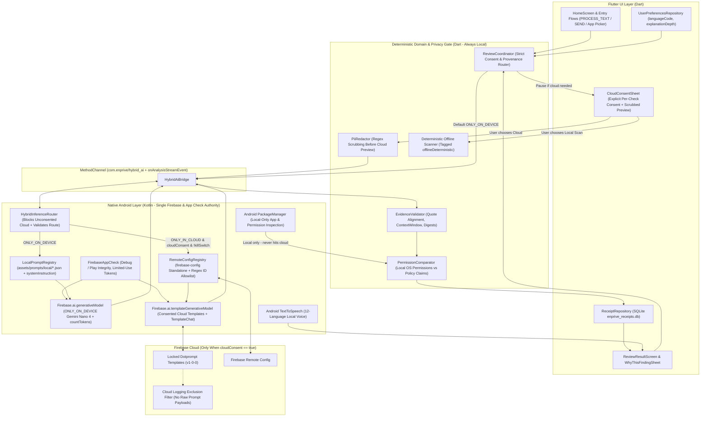

# 🔭 Enprive AI Architecture Scout & Discovery Report (`scout-discover.md`)

> **Scope**: Complete, exhaustive architectural discovery combining a forensic audit of the actual Enprive repository (`lib/`, `android/`, `ios/`, `test/`, `pubspec.yaml`, Gradle cache bytecode via `javap`, and `docs/*.docx`) with verified official Firebase documentation (**Firebase AI Logic Server Prompt Templates**, **Hybrid / On-Device Inference**, **AI Monitoring & Cloud Logging**, **Firebase Remote Config**, `pub.dev` FlutterFire packages, and **Isaac Adariku's *Reflection* case study**).
>
> **Metadata**:
> - **Date**: 2026-11-13
> - **Application / Package**: `enprive` / `com.example.enprive`
> - **Firebase Project**: `enprive-hybrid-ai` (Project Number `71373777460`, storage bucket `enprive-hybrid-ai.firebasestorage.app`, `firebase.json` `{}`)
> - **Branch Inspected**: `feature/splash-and-deni-icon` (`HEAD 24c880a` + splash screen & Deni `A1` smile icon changes)
> - **Operational Constraint**: Strict read-only architectural investigation and recommendation synthesis. Zero application source files, Gradle configurations, Firebase Console settings, Remote Config parameters, or template definitions were altered.
> - **Companion Specification Docs**:
>   - [ai-prompt-management-investigation.md](./ai-prompt-management-investigation.md)
>   - [ai-prompt-management-architecture.md](./ai-prompt-management-architecture.md)
>   - [ai-prompt-migration-plan.md](./ai-prompt-migration-plan.md)

### Evidence Discipline Legend
Every statement in this discovery is categorized strictly as:
- **`[FACT]`**: Directly observed in repository files (with exact file paths, classes, methods, line numbers), compiled `firebase-ai-18.2.0-api.jar` bytecode, tool output (`flutter analyze`, `flutter test`), or official Firebase documentation checked on 2026-11-13.
- **`[REC]`**: Engineering recommendation synthesized from observed facts and Enprive's `#BuildHybridAI 2026` privacy/evidence guarantees.
- **`[UNCERTAIN]`**: Behavior or capability outside verified documentation or requiring live staging verification during Proof of Concept (POC).

---

## 1. Executive TL;DR

1. **`[FACT]` Native Kotlin Owns 100% of Firebase AI Inference Today**: Contrary to earlier planning briefs that envisioned Flutter `firebase_ai` calling cloud Gemini endpoints from Dart while Kotlin handled only Gemini Nano 4, `pubspec.yaml` contains **zero Firebase dependencies** (`firebase_core`, `firebase_ai`, `firebase_app_check`, and `firebase_remote_config` are completely absent). Both `ONLY_ON_DEVICE` and cloud Gemini inference live inside `android/app/src/main/kotlin/com/example/enprive/MainActivity.kt`, backed by `com.google.firebase:firebase-ai:18.2.0` and `com.google.firebase:firebase-ai-ondevice:16.0.0-beta08` (`android/app/build.gradle.kts:60-65`). Meanwhile, `ios/Runner/AppDelegate.swift` is a default template stub with zero Firebase or AI implementation.
2. **`[FACT]` Kotlin `firebase-ai:18.2.0` Already Bundles Server Prompt Template APIs**: Bytecode inspection (`javap`) of the project's cached `firebase-ai-18.2.0-api.jar` confirms `FirebaseAI.templateGenerativeModel(...)`, `TemplateGenerativeModel`, `TemplateChat`, `TemplateTool`, `TemplateToolConfig`, `TemplateGenerativeModelFutures`, `GenerateContentResponse.getUsageMetadata()`, and `GenerateContentResponse.getModelVersion()` are **already compiled into Enprive's existing dependency**. By contrast, Flutter's `firebase_ai` (`5.1.0` on `pub.dev`) marks `TemplateGenerativeModel` as `@experimental` and would split Firebase/App Check initialization across Dart and Kotlin.
3. **`[FACT]` Critical Privacy Regression — Silent Cloud Escalation**: While `MainActivity.kt:365` blocks `ONLY_IN_CLOUD` without `cloudConsent`, and `lib/widgets/cloud_consent_sheet.dart` implements a complete per-check disclosure sheet (`CloudConsentSheet`), **`ReviewCoordinator.runPolicyReview` (`L160-256`) and `askDeniAboutFinding` (`L406-466`) bypass consent completely**. Whenever text is comprehensive (`>1,400 chars` or `>220 words` per `PiiRedactor`) or `ONLY_ON_DEVICE` fails/returns unavailable, `ReviewCoordinator` runs regex PII scrubbing (`PiiRedactor.redact`) and immediately invokes `_bridge.analyseText(..., cloudConsent: true, requestedMode: 'PREFER_ON_DEVICE')`. `CloudConsentSheet` and `ReviewExecutionResult.requiresConsentChoice` have **zero production callers**, and `test/review_coordinator_test.dart:98-219` currently tests/asserts this silent cloud escalation!
4. **`[FACT]` Hardcoded Prompts, Unused Preferences & Deterministic Fallback Mislabeling**:
   - Only **2** AI prompt instructions exist across the entire repo, both raw Kotlin string literals concatenated with `"$systemPrompt\n\n--- POLICY TEXT ---\n$text"` inside `MainActivity.kt` (`L413-457`, no `systemInstruction` separation, no native `Schema`).
   - `ExplanationDepth` (`simple`, `balanced`, `detailed`) is persisted in `UserPreferencesRepository` (`lib/services/storage/receipt_repository.dart:145-234`) and selectable in Onboarding & Settings, yet **never forwarded** to `ReviewCoordinator`, `HybridAiBridge`, or `MainActivity.kt`.
   - `ReviewCoordinator.buildDeterministicLocalReceipt` (`L142, L314, L698+`) runs offline regex rules with `source: InferenceSource.onDevice`, making deterministic heuristic fallback indistinguishable from real Gemini Nano 4 inference on receipt chips.
5. **`[FACT]` Hard Firebase Platform Constraints That Shape the Design**:
   - **No Hybrid/On-Device Templates**: Firebase Server Prompt Templates (Public Preview, no SLA) run exclusively on server-side cloud Gemini models and **do not support** `ONLY_ON_DEVICE`, `PREFER_ON_DEVICE`, Gemini Nano, Gemini Live API, or enum-list output schemas.
   - **Global "Template-Only Mode" Breakage Hazard**: Enabling project-wide Template-Only mode in Firebase Console rejects every non-template `GenerativeModel` request with `403 Unauthorized`, which would break `PREFER_ON_DEVICE` cloud fallback and any future `LiveGenerativeModel` stream.
   - **GCP Prompt/Response Logging Hazard**: Enabled Firebase AI Monitoring logs full prompt inputs and model responses in Google Cloud Logging & Trace by default unless an exclusion filter (`resource.type="firebasevertexai.googleapis.com/Client"`) is configured on the `_Default` sink.
6. **`[REC]` Core Strategic Verdict**: **`ADOPT WITH MODIFICATIONS`** Server Prompt Templates via Kotlin `TemplateGenerativeModel` strictly for **explicitly consented cloud-only features**—starting with **`enprive-finding-explanation-cloud-v1-0-0`** as the smallest safe POC—paired with standalone Android **`firebase-config`** (without `firebase-analytics`), regex allowlist validation, and Git/asset-based **`LocalPromptRegistry`** versioning for `ONLY_ON_DEVICE` Gemini Nano 4. **Block any cloud template rollout until Phase A resolves the `ReviewCoordinator` silent fallback bug and GCP prompt-body logging.**

---

## 2. Forensic Repository Reconnaissance

### 2.1 Project Topology & Dependency Reality

- **Flutter / Dart (`pubspec.yaml`)**:
  - `[FACT]` Dart SDK `^3.13.7`; dependencies limited to UI, fonts, localization, and local persistence: `intl: ^0.20.3`, `shared_preferences: ^2.5.6`, `sqflite: ^2.4.6`, `path: ^1.9.1`, `google_fonts: ^9.0.0`, `loading_animation_widget: ^1.3.0`, `shimmer: ^4.0.0`, `animated_status_card: ^0.0.1`, `beautiful_timeline: ^0.1.0`, `lucide_icons_flutter: ^4.0.3`, `iconify_flutter: ^0.0.7`.
  - `[FACT]` Zero FlutterFire packages (`firebase_core`, `firebase_ai`, `firebase_app_check`, `firebase_remote_config`) exist in `pubspec.yaml`.
  - `[FACT]` Bundled fonts (`Nunito`, `SourceSerif4`, `Inter`) with `GoogleFonts.config.allowRuntimeFetching = false` (`lib/main.dart:36`) ensure offline rendering.
- **Android Build & Manifest (`android/app/build.gradle.kts`, `AndroidManifest.xml`, `google-services.json`, `local.properties`)**:
  - `[FACT]` `applicationId = "com.example.enprive"`, `minSdk = 26` (explicitly required by `firebase-ai-ondevice` / ML Kit Prompt API), Java/Kotlin target JVM 17.
  - `[FACT]` Google Services plugin `com.google.gms.google-services` configured against `enprive-hybrid-ai` (`project_number = 71373777460`).
  - `[FACT]` Dependencies pinned in `android/app/build.gradle.kts:60-65`:
    - `com.google.firebase:firebase-bom:33.7.0`
    - `com.google.firebase:firebase-ai:18.2.0` *(pinned explicitly because `firebase-ai` had no version inside BoM `33.7.0`, per `journal.md` Iteration 2)*
    - `com.google.firebase:firebase-ai-ondevice:16.0.0-beta08`
    - `com.google.firebase:firebase-appcheck-debug`
    - `com.google.firebase:firebase-appcheck-playintegrity`
    - `org.jetbrains.kotlinx:kotlinx-coroutines-android:1.8.1`
  - `[FACT]` `android/local.properties` holds keys `sdk.dir`, `flutter.sdk`, `flutter.buildMode`, `flutter.versionName`, `flutter.versionCode` (with optional `APP_CHECK_DEBUG_TOKEN` injected via `manifestPlaceholders["firebaseAppCheckDebugSecret"]` at `build.gradle.kts:36-37`).
  - `[FACT]` `AndroidManifest.xml:29-39, 48-60` registers `ACTION_PROCESS_TEXT` (`text/plain`) and `ACTION_SEND` (`text/plain`), plus scoped `<queries>` for `PROCESS_TEXT`, `MAIN/LAUNCHER`, and `TTS_SERVICE` (**no `QUERY_ALL_PACKAGES`**).
- **iOS (`ios/Runner/AppDelegate.swift`, `ios/Runner/Info.plist`)**:
  - `[FACT]` Standard `FlutterAppDelegate` template only; zero Firebase initialization, zero AI logic, and zero `com.enprive/hybrid_ai` method channel handlers.

### 2.2 Flutter Presentation, State & Localization Layer (`lib/`)

| File & Symbols | Observed Behavior | Gaps / Relevant Investigation Findings |
|---|---|---|
| `lib/main.dart` (`EnpriveApp`, `HomeScreen`, `_HomeScreenState`) | Manages splash (`EnpriveSplashScreen`), first-run onboarding, incoming `PROCESS_TEXT`/`SEND` intent retrieval on startup/resume (`_checkIncomingTextIntent`), 3-tab dock (`Home · Receipts · Settings`), sample policy fixtures (`_fallbackEduTrackFixture`, `_fallbackCalmMathFixture`), `_executePolicyReview` (`L311+`), `_showCheckAppModal`, `_showPasteModal`, and `_explanationDepth` state (`L129`). | `[FACT]` All callers of `coordinator.runPolicyReview(...)` (`L327`, `L959`, `L1233`, `L1247`) omit `cloudConsent` (`false`). Link/URL mode (`L1207-1239`) does **not** fetch HTTP URLs—it resolves `'calmmath'` substring to `_fallbackCalmMathFixture` or defaults to `_fallbackEduTrackFixture`. |
| `lib/screens/review_result_screen.dart` (`ReviewResultScreen`) | Displays calibrated 3-state hero (`reviewRecommended`, `noConcern`, `insufficientEvidence`), quote-first finding cards, local Android permission comparison (`_CleanPermissionListCard`), captured policy snapshot modal (`_showSnapshotReceiptSheet`), `AnalysisSavedTraceCard` (`thoughtSummary` + `thoughtSignature`), Android TTS playback (`_toggleVoicePlayback` calling `bridge.speakText`), and opens `WhyThisFindingSheet` (`_openFindingDetails`). | `[FACT]` Passes `cloudConsentGrantedForSession` to `WhyThisFindingSheet`, yet `WhyThisFindingSheet` has no consent prompt gate if `cloudConsentGrantedForSession == false`. No machine-translation toggle or side-by-side policy viewer exists. |
| `lib/widgets/why_this_finding_sheet.dart` (`WhyThisFindingSheet`) | Renders one unified Evidence Work Card + 3 localized preset Question Chips (`meaning`, `opt_out`, `unknown`) calling `coordinator.askDeniAboutFinding(...)` (`L86`). Includes docked `DeniAnimatedMascot` + primary CTA. | `[FACT]` Single-turn Q&A only via 3 fixed chips; no free-form question input, no multi-turn conversation history, and no `ExplanationDepth` integration. |
| `lib/widgets/cloud_consent_sheet.dart` (`CloudConsentSheet`, `CloudConsentDecision`) | Complete B19-styled bottom sheet presenting scrubbed payload preview (`redactedPreview`) and explicit buttons returning `useCloudOnce`, `reviewLocallyInstead`, or `cancel`. | `[FACT]` **Present but unused**: `rg` across `lib/` confirms **zero callers** outside its own widget file! |
| `lib/widgets/private_readiness_sheet.dart` (`PrivateReadinessSheet`) & `lib/widgets/installed_app_picker_sheet.dart` (`InstalledAppPickerSheet`) | `PrivateReadinessSheet` invokes `downloadOrCheckModel()`, `warmUpModel()`, and `getDeviceCapability()`. `InstalledAppPickerSheet` calls `bridge.listLaunchableApps()` and `bridge.inspectAppSnapshot(packageName)` strictly on-device. | `[FACT]` Cleanly implements on-device readiness & privacy-preserving `PackageManager` inspection. |
| `lib/screens/settings_screen.dart` & `lib/screens/onboarding_flow_screen.dart` | Both expose 3-tier `ExplanationDepth` cards (`simple`, `balanced`, `detailed`) and 12-language selection. `OnboardingFlowScreen` configures preferences; `SettingsScreen` adds readiness check & SQLite receipt clear. | `[FACT]` Neither `OnboardingFlowScreen` nor `SettingsScreen` has a "Hide Deni" toggle (intentionally removed in commit `3086e5c`). `ExplanationDepth` saves cleanly to `SharedPreferences` but ends there without affecting prompts. |
| `lib/screens/receipts_screen.dart` (`ReceiptsScreen`) | Local SQLite archive viewer with live text search, state filter chips (`All · Review · No concern`), `Open receipt`, and `Delete`. | `[FACT]` Purely local; displays saved `PolicyReviewReceipt` objects. |
| `lib/l10n/enprive_languages.dart` (`kEnpriveLanguages`) & `.arb` files | 12 localized languages (`en`, `ko`, `es`, `fr`, `de`, `ar` [RTL], `ja`, `zh`, `hi`, `pt`, `it`, `ru`), each with `nativeName`, `englishName`, `shortBadge`, and `bcp47Tag`. | `[FACT]` Full `.arb` UI coverage + TTS tags + `$targetLanguage` prompt injection, **without** routing checks against Gemini Nano 4's validated EN/KO language bounds. |

### 2.3 Deterministic Domain, Privacy & Persistence Layer (`lib/domain/` & `lib/services/`)

1. **`EvidenceValidator` (`lib/domain/evidence/evidence_validator.dart:1-125`) — `[FACT]` Working**:
   - `normalize(input)` collapses `\s+` -> `' '`, normalizes curly quotes (`“ ” ’ ‘`) to ASCII quotes, trims, and strips symmetric outer wrapping quotes.
   - `verifyQuoteAlignment(quote, snapshotText)` performs `normalizedSnapshot.contains(normalizedQuote)` — an **exact, case-sensitive substring match after whitespace/quote normalization**.
   - `validateFinding` (`L38-74`) checks `validEvidenceIds` membership and `verifyQuoteAlignment`, classifying `SOURCE_MATCHED`, `INTERPRETATION` (if evidence ID matches without quote alignment), or `UNVERIFIED` (appending *"Quoted excerpt could not be matched to the captured policy snapshot."*).
   - `extractContextWindow` (`L79-104`) extracts `(before, matched, after)` using `radius = 85` around the matched offset.
   - `computeSnapshotDigest` (`L108-124`) produces a deterministic 16-hex-char dual-accumulator FNV-1a digest.

2. **`ReviewCoordinator` (`lib/domain/review/review_coordinator.dart:1-922`) — `[FACT]` Mixed (Strong Validator, Broken Consent Gate)**:
   - `ReviewExecutionResult.requiresConsentChoice` (`L28-33`): Dead code; never constructed in `runPolicyReview`.
   - `runPolicyReview` (`L83-330`):
     - If `forceLocalManualScan == true` (`L124-153`): invokes `buildDeterministicLocalReceipt(..., source: InferenceSource.onDevice)`.
     - Else checks `PiiRedactor.isComprehensivePolicy(trimmed)` (`L157`). If false and `!cloudConsent`, calls `_bridge.analyseText(..., requestedMode: 'ONLY_ON_DEVICE', cloudConsent: false)` (`L160-175`).
     - **Silent Fallback Path (`L229-256`)**: If comprehensive OR if `ONLY_ON_DEVICE` fails/returns unavailable, runs `PiiRedactor.redact(trimmed)` and **immediately calls** `_bridge.analyseText(..., text: redaction.redactedText, cloudConsent: true, requestedMode: 'PREFER_ON_DEVICE')` without prompting the user.
     - **Offline Fallback (`L296-326`)**: If cloud/hybrid fails too, runs `buildDeterministicLocalReceipt(..., source: InferenceSource.onDevice)`.
   - `askDeniAboutFinding` (`L376-466`): Identical silent escalation—runs `ONLY_ON_DEVICE` if short (`<= comprehensive` threshold) and `!cloudConsent`, and on failure or long composite text calls `PiiRedactor.redact` + `cloudConsent: true, requestedMode: 'PREFER_ON_DEVICE'`.
   - `_parseAndValidateBridgeOutput` (`L557-693`):
     - Checks every concern's `quote` via `EvidenceValidator.validateFinding` against `snapshotText` AND falls back to checking `redactedSnapshotText` (`L587-598`) so scrubbed `[EMAIL]`/`[PHONE]` placeholders remain valid quotes!
     - Defensively normalizes `category` (`_parseCategory`), `severity` (`_parseSeverity`), and `overall_state`: clamps to `insufficientEvidence` whenever findings fail quote verification or `REVIEW_RECOMMENDED` lacks verified findings (`L653-665`).
     - Populates static `whatAndroidReports = 'Text-only policy review...'` unless enriched by `_attachPermissionComparison` (`L332-372`), which merges `AppPermissionSnapshot` deterministically on-device.

3. **`VerifiedFinding` & `PolicyReviewReceipt` (`lib/domain/review/review_models.dart:1-251`) — `[FACT]`**:
   - Enums: `ReviewOverallState { noConcern, reviewRecommended, insufficientEvidence }`, `EvidenceStatus { sourceMatched, deviceObserved, interpretation, unverified }`, `FindingCategory { dataCollection, sharing, tracking, retention, parentalConsent }`, `FindingSeverity { high, medium, low }`.
   - Gap vs. Section 6's 9 required finding fields: `VerifiedFinding` has `id`, `title`, `category`, `severity`, `exactExcerpt`, `explanation`, `whatPolicySays`, `whatAndroidReports`, `unknowns`, `status`, `contextWindow`. It lacks explicit per-finding `evidenceIds` (`List<String>`), character-offset `sourceReference` pointer, and per-finding `reviewTimestamp` (which sits on `PolicyReviewReceipt.createdAt`).

4. **`PiiRedactor` (`lib/domain/privacy/pii_redactor.dart:1-129`) — `[FACT]`**:
   - Thresholds: `comprehensiveCharThreshold = 1400`, `comprehensiveWordThreshold = 220`.
   - Regex patterns mask email addresses, SSNs, labeled IDs (`Student ID`, `User ID`, etc.), US/international phone formats, IPv4 addresses, English street suffixes (`Street/St/Ave/Rd/...`), and labeled person prefixes (`Parent:`, `Child:`, `Student:`).
   - Limitation: Cannot reliably mask free-form personal names or non-English address/ID formats across Enprive's 11 non-English languages.

5. **`PermissionComparator` (`lib/domain/permissions/permission_comparator.dart`) — `[FACT]`**:
   - Strictly deterministic local matcher comparing `ACCESS_FINE_LOCATION`, `ACCESS_BACKGROUND_LOCATION`, `RECORD_AUDIO`, `CAMERA`, `READ_CONTACTS`, `com.google.android.gms.permission.AD_ID`, and `READ_MEDIA_IMAGES` against policy text disclosures; attaches `calibratedLimitationNotice`. Never touches network or AI models.

6. **`ReceiptRepository` & `UserPreferencesRepository` (`lib/services/storage/receipt_repository.dart:1-234`) — `[FACT]`**:
   - Local SQLite (`enprive_receipts.db`, table `policy_receipts`) storing full receipt JSON (plus in-memory test fallback).
   - `UserPreferencesRepository` persists `enprive_pref_explanation_depth`, `enprive_pref_language_code`, and `enprive_pref_completed_onboarding` in `SharedPreferences`.

### 2.4 Platform Channel & Native Android Runtime (`HybridAiBridge` <-> `MainActivity.kt`)

- **Bidirectional Channel (`com.enprive/hybrid_ai`)**:
  - `[FACT]` Both synchronous/async requests (Dart -> Kotlin) and incremental reasoning/progress streams (Kotlin -> Dart) travel over **one `MethodChannel('com.enprive/hybrid_ai')`** (`HybridAiBridge._channel` at `hybrid_ai_bridge.dart:154`, `MainActivity.kt:40, 470`). Kotlin invokes `methodChannel?.invokeMethod("onAnalysisStreamEvent", ...)` on `Dispatchers.Main`; Dart receives it via `HybridAiBridge._ensureHandlerBound()` (`L173-193`) into a broadcast `StreamController<AnalysisStreamEvent>`. (No separate `EventChannel` is used.)
- **Implemented MethodChannel Operations (`MainActivity.kt:142-626`)**:
  1. `getDeviceCapability` (`L144-184`): Guards `apiLevel < 26`, invokes `createOnDeviceModel().onDeviceExtension?.checkStatus()`, maps `AVAILABLE` / `DOWNLOADABLE` / `DOWNLOADING` / `UNAVAILABLE`.
  2. `downloadOrCheckModel` (`L186-205`): Collects `ext.download()` flow if status is `DOWNLOADABLE`.
  3. `warmUpModel` (`L207-221`): Invokes `ext?.warmUp()`.
  4. `getInitialSelectedText` (`L223-227`): Reads/clears text captured from `ACTION_PROCESS_TEXT` (`EXTRA_PROCESS_TEXT`) or `ACTION_SEND` (`EXTRA_TEXT`).
  5. `speakText` (`L229-250`) & `stopSpeaking` (`L252-259`): Uses local Android `TextToSpeech` with `resolveBcp47Locale` (`L629-646`) supporting all 12 Enprive languages.
  6. `listLaunchableApps` (`L261-307`) & `inspectSelectedApp` (`L309-346`): Local `PackageManager` query returning launcher apps + requested/granted permissions (`PackageInfo.GET_PERMISSIONS`), explicitly annotated `"never leaves the device"`.
  7. `analyseText` (`L349-622`):
     - Reads `schemaVersion`, `requestId`, `task`, `text`, `cloudConsent`, `requestedMode`, `languageCode`.
     - **Guard (`L365-375`)**: Returns `errorCode = "CLOUD_CONSENT_REQUIRED"` if `!cloudConsent && requestedMode == "ONLY_IN_CLOUD"`.
     - **Mode Resolution (`L379-383`)**: `!cloudConsent -> InferenceMode.ONLY_ON_DEVICE`, `requestedMode == "ONLY_IN_CLOUD" -> ONLY_IN_CLOUD`, else `PREFER_ON_DEVICE`.
     - **Model Init (`L385-411`)**: `Firebase.ai(backend = GenerativeBackend.googleAI(), useLimitedUseAppCheckTokens = true)`, `generativeModel(modelName = "gemini-3.8-flash", generationConfig = { responseMimeType = "application/json"; temperature = 0.1f; thinkingConfig? { includeThoughts = true; thinkingLevel = ThinkingLevel.LOW } }, onDeviceConfig = OnDeviceConfig(... modelOption = OnDeviceModelOption.PREVIEW, maxOutputTokens = 1024, topK = 20, temperature = 0.1f))`.
     - **Hidden Bugs/Smells Observed**:
       - `OnDeviceConfig` (`L402-410`) is constructed and passed even when `inferenceMode == InferenceMode.ONLY_IN_CLOUD`.
       - `mapSource(src)` (`L486-490`) falls back to `if (cloudConsent) "IN_CLOUD" else "ON_DEVICE"` if `lastInferenceSource` is `null` rather than reporting `"UNKNOWN"`.
       - `preferThoughts = inferenceMode != InferenceMode.ONLY_ON_DEVICE` (`L552`) retries `collectStream(false)` if thinking fails before output arrives (`L559-561`), **does not read `chunk.usageMetadata` or `chunk.modelVersion`**, and strips markdown code fences before `JSONObject(cleaned)` parsing (`L579-585`).
- **App Check Setup (`MainActivity.kt:64-76`)**:
  - `[FACT]` `(applicationInfo.flags and ApplicationInfo.FLAG_DEBUGGABLE) != 0` switches `DebugAppCheckProviderFactory` vs. `PlayIntegrityAppCheckProviderFactory`. Every AI instance passes `useLimitedUseAppCheckTokens = true` (`L114, L387`).

---

## 3. Complete 12-Area AI Architecture Inventory Table

Statuses follow the exact 5-tier taxonomy: **Implemented and working** · **Implemented but incomplete** · **Present but unused** · **Planned in documentation** · **Completely absent**.

| # | Area | Classification | Actual Source Location (File / Class / Method / Line / Config) | Discrepancies, Constraints & Architectural Impact |
|---|---|---|---|---|
| **1** | **Prompt locations** | **Implemented but incomplete** | Kotlin string literals in [MainActivity.kt](file:///Users/mi-tech/projects/apps/enprive/android/app/src/main/kotlin/com/example/enprive/MainActivity.kt#L413-L457): 1. `task == "explain_finding"` (`L414-426`) 2. Policy analysis prompt fallback (`L428-455`) | Only 2 AI prompts exist. Planned templates for multi-turn Deni, policy document translation, and `ExplanationDepth` tuning do not exist yet. No external `.prompt` or JSON asset prompt files exist; deterministic offline keywords live separately in `ReviewCoordinator.buildDeterministicLocalReceipt` (`L698+`). |
| **2** | **Prompt construction** | **Implemented and working** *(weak separation)* | [MainActivity.kt](file:///Users/mi-tech/projects/apps/enprive/android/app/src/main/kotlin/com/example/enprive/MainActivity.kt#L413-L457) interpolates `$targetLanguage`, `$task`, and concatenates `"$systemPrompt\n\n--- POLICY TEXT ---\n$text"` (`L457`) before `generateContentStream(prompt)` (`L502`). `askDeniAboutFinding` (`review_coordinator.dart:385-386`) formats `Question + Quoted Clause + snapshotText` into `text`. | Does **not** pass Kotlin `systemInstruction = content { ... }` parameter on `generativeModel(...)` (`L390-411`). Untrusted policy text shares the same user prompt buffer as system instructions, relying heavily on downstream `EvidenceValidator` to defeat prompt injection. `ExplanationDepth` is omitted. |
| **3** | **Model selection** | **Implemented and working** *(static binary constants)* | [MainActivity.kt](file:///Users/mi-tech/projects/apps/enprive/android/app/src/main/kotlin/com/example/enprive/MainActivity.kt#L112-L126) (`createOnDeviceModel`) & [MainActivity.kt](file:///Users/mi-tech/projects/apps/enprive/android/app/src/main/kotlin/com/example/enprive/MainActivity.kt#L390-L411) (`createModel`): both pin `modelName = "gemini-3.8-flash"`, `OnDeviceModelOption.PREVIEW`, `GenerativeBackend.googleAI()`, `temperature = 0.1f`, `topK = 20`, `maxOutputTokens = 1024`, `ThinkingLevel.LOW`. | `android/app/build.gradle.kts:60-65` pins `firebase-bom:33.7.0`, `firebase-ai:18.2.0`, `firebase-ai-ondevice:16.0.0-beta08`. Any model update (`gemini-3.8-flash` -> newer version) or temperature/token adjustment currently requires a Kotlin edit + new APK release. |
| **4** | **Local inference** | **Implemented and working** *(Android-only)* | • Lifecycle: `MainActivity.kt` `getDeviceCapability` (`L144`), `downloadOrCheckModel` (`L186`), `warmUpModel` (`L207`) via `onDeviceExtension` • Inference: `OnDeviceConfig(mode = InferenceMode.ONLY_ON_DEVICE, modelOption = OnDeviceModelOption.PREVIEW)` (`L402-410`) • Fallback: `ReviewCoordinator.buildDeterministicLocalReceipt` (`L698+`) • iOS: **Completely absent** (`ios/Runner/AppDelegate.swift`). | **Provenance Masking Gap**: `buildDeterministicLocalReceipt` (`L146, L318`) hardcodes `InferenceSource.onDevice`, verified in `test/review_coordinator_test.dart:249`. Receipts cannot distinguish Gemini Nano 4 local inference from regex fallback in UI provenance chips. Also `countTokens()` is never called to check the documented 6,000-token Nano ceiling before fallback. |
| **5** | **Cloud inference** | **Implemented and working** *(single SDK)* | [MainActivity.kt](file:///Users/mi-tech/projects/apps/enprive/android/app/src/main/kotlin/com/example/enprive/MainActivity.kt#L385-L601) invokes `Firebase.ai(backend = GenerativeBackend.googleAI(), useLimitedUseAppCheckTokens = true).generativeModel(...)` with `thinkingConfig`, streaming chunks via `"onAnalysisStreamEvent"` (`L470`), retrying without thoughts on failure (`L559-561`), and parsing via `JSONObject` (`L584-585`). | **Contradicts Brief v3** (which assumed Flutter `firebase_ai` plugin would run cloud requests). `pubspec.yaml` has zero Firebase packages. Meanwhile `firebase-ai:18.2.0` *already ships* `TemplateGenerativeModel`, unused today. |
| **6** | **Request routing** | **Implemented but incomplete** *(Critical Consent Regression)* | • Kotlin gate (`MainActivity.kt:365-383`): blocks `!cloudConsent && requestedMode == "ONLY_IN_CLOUD"`, else `!cloudConsent -> ONLY_ON_DEVICE`, `ONLY_IN_CLOUD`, or `PREFER_ON_DEVICE`. • Dart orchestration ([review_coordinator.dart](file:///Users/mi-tech/projects/apps/enprive/lib/domain/review/review_coordinator.dart#L157-L256), [`L406-L466`](file:///Users/mi-tech/projects/apps/enprive/lib/domain/review/review_coordinator.dart#L406-L466)): routes comprehensive text (`>1400 chars`/`>220 words`) OR failed `ONLY_ON_DEVICE` automatically into `PiiRedactor.redact` + `cloudConsent: true, requestedMode: 'PREFER_ON_DEVICE'`. | **Contradicts Product Specs & `AGENTS.md §3.2`**: `CloudConsentSheet` (`lib/widgets/cloud_consent_sheet.dart`) and `ReviewExecutionResult.requiresConsentChoice` (`L28-33`) are dead code with zero callers (`lib/main.dart` always omits `cloudConsent`), while `test/review_coordinator_test.dart:98-219` codifies silent escalation! Additionally, unsupported Nano languages outside EN/KO are not gated before `ONLY_ON_DEVICE`. |
| **7** | **Response contracts** | **Implemented and working** *(prompt-defined JSON)* | • Bridge DTO: `HybridAiBridge.analyseText` (`hybrid_ai_bridge.dart:295-340`) + `HybridAnalysisResult` (`schemaVersion`, `requestId`, `status`, `inferenceSource`, `structuredOutput`, `thoughtSummary`, `thoughtSignature`) • Model JSON contract: `responseMimeType = "application/json"` (`MainActivity.kt:393`) + textual JSON schema in prompt strings (`L419-451`) + defensive Dart parser `_parseAndValidateBridgeOutput` (`L557-693`). | No native Firebase `Schema` (`responseSchema`) object is constructed in `MainActivity.kt`. Model output is untrusted and coerced defensively into `FindingCategory`, `FindingSeverity`, and `ReviewOverallState` in Dart (`L617-665`). |
| **8** | **Evidence validation** | **Implemented and working** *(deterministic Dart)* | • [evidence_validator.dart](file:///Users/mi-tech/projects/apps/enprive/lib/domain/evidence/evidence_validator.dart): `normalize`, `verifyQuoteAlignment`, `validateFinding`, `extractContextWindow`, `computeSnapshotDigest` • [review_coordinator.dart](file:///Users/mi-tech/projects/apps/enprive/lib/domain/review/review_coordinator.dart#L581-L658): validates `quote` against both raw `snapshotText` and `redactedSnapshotText`; clamps unverified/empty `REVIEW_RECOMMENDED` to `insufficientEvidence` • [permission_comparator.dart](file:///Users/mi-tech/projects/apps/enprive/lib/domain/permissions/permission_comparator.dart): deterministic local OS permission matching. | Missing full 9-field finding citation schema on `VerifiedFinding` (`evidenceIds`, character-span `sourceReference`, and per-finding `reviewTimestamp`, which currently sits on `PolicyReviewReceipt.createdAt`). |
| **9** | **Deni** | **Implemented but incomplete** | • Mascot animation (`DeniAnimatedMascot` 6 poses + `A1` icon): **Implemented and working** • Single-turn Q&A: [why_this_finding_sheet.dart](file:///Users/mi-tech/projects/apps/enprive/lib/widgets/why_this_finding_sheet.dart) (3 preset chips) -> `askDeniAboutFinding` -> `MainActivity.kt` `task == "explain_finding"` (`L414-426`) • Multi-turn `TemplateChat` / free-form input / Gemini Live: **Completely absent / Planned in docs**. | **Present but unused**: `ExplanationDepth` (`simple`/`balanced`/`detailed`) persisted in `UserPreferencesRepository` (`receipt_repository.dart:145-234`) is never passed to Deni. **Discrepancy**: `Addendum v2 §3` requested a "Hide Deni" setting, which commit `3086e5c` removed. `speakText` is local Android TTS (`MainActivity.kt:229-250`), not Gemini Live. |
| **10** | **Translation** | **Implemented but incomplete** | • 12-language UI localization (`.arb` + `kEnpriveLanguages`), `resolveBcp47Locale` Android TTS tags (`MainActivity.kt:629-646`), and `$targetLanguage` JSON field localization while holding `quote` untranslated (`MainActivity.kt:453`): **Implemented and working** • Dedicated policy passage/document translation mode & side-by-side derived view (*Addendum v2*, *Master Spec v3*): **Planned in docs / Completely absent**. | Currently only summary/finding JSON descriptions translate at analysis time (`languageCode`). Users cannot open a dedicated translated side-by-side policy viewer with machine-translation notices and preserved canonical excerpts. |
| **11** | **Remote configuration** | **Completely absent** | Zero `firebase-config` dependency in `android/app/build.gradle.kts`; zero `firebase_remote_config` in `pubspec.yaml`; no XML defaults or fetch/activate lifecycle anywhere. | All prompts, model IDs, parameters, and cloud routing toggles are compiled statically into binaries. |
| **12** | **Security & Observability** | **Implemented but incomplete** | • App Check: **Implemented and working** (`MainActivity.kt:65-76`, `useLimitedUseAppCheckTokens = true` at `L114` & `L387`, `local.properties` placeholder at `build.gradle.kts:36-37`) • App inventory privacy: **Implemented and working** (`AndroidManifest.xml` scoped `<queries>`, local-only `inspectSelectedApp`) • PII redaction: **Implemented and working** (`PiiRedactor.redact`) • Per-check consent UI: **Present but unused** (`CloudConsentSheet`) • Non-sensitive telemetry (`UsageMetadata`, latency, `promptVersion`): **Completely absent**. | • `PiiRedactor` regex misses unstructured names & non-English IDs/addresses. • `Url` mode in `lib/main.dart:1207-1239` uses static `'calmmath'`/`EduTrack` fixture routing (`no HTTP fetch`). • Firebase AI Monitoring logs full prompt payloads to Cloud Logging by default unless excluded. • `GenerateContentResponse.getUsageMetadata()` & `modelVersion` (present in `firebase-ai:18.2.0`) are discarded. |

---

## 4. Forensic Discrepancy Register (Codebase vs. Product Documentation)

| # | Contradiction | What Documentation / Rules Require | What Source Code Actually Does | Severity |
|---|---|---|---|---|
| **D1** | **Silent Cloud Fallback vs. Explicit Per-Check Consent** | `Master Spec v3`, `Addendum v1`, `AGENTS.md §3.2`, and `lib/widgets/cloud_consent_sheet.dart`: Never silently fall back from `ONLY_ON_DEVICE`; show disclosure + scrubbed preview and wait for explicit per-check consent. | `ReviewCoordinator.runPolicyReview` (`L232-256`) & `askDeniAboutFinding` (`L441-466`) scrub PII via `PiiRedactor` and flip `cloudConsent: true, requestedMode: 'PREFER_ON_DEVICE'` silently. `CloudConsentSheet` & `ReviewExecutionResult.requiresConsentChoice` have `0` production callers. | **CRITICAL (Blocking)** |
| **D2** | **Flutter `firebase_ai` vs. Kotlin-Only `firebase-ai`** | `Brief v3` planned Flutter `firebase_ai` for cloud calls alongside Kotlin for on-device Nano 4. | `pubspec.yaml` has zero Firebase dependencies; `MainActivity.kt` runs both local and cloud AI via `com.google.firebase:firebase-ai:18.2.0`. | **HIGH (Architectural)** |
| **D3** | **6,000-Token Nano Ceiling vs. 1,400-Char Heuristic & Language Bounds** | Official docs specify a `6,000`-token ceiling for Gemini Nano on-device (Brief v3 cited `~4,000` tokens & EN/KO validation only). | `PiiRedactor.comprehensiveCharThreshold = 1400` / `220 words` (~300–400 tokens) skips `ONLY_ON_DEVICE` way below hardware capacity, while non-EN/KO short inputs attempt `ONLY_ON_DEVICE` without checking Nano language support or `countTokens()`. | **MEDIUM** |
| **D4** | **Deterministic Regex Scanner Masquerading as Gemini Nano 4** | Product specs require reporting actual Firebase AI Logic `InferenceSource`. | `ReviewCoordinator.buildDeterministicLocalReceipt` (`L146, L318`) passes `InferenceSource.onDevice`, indistinguishable from real Nano 4 AI on receipt chips (`widget`/`review_coordinator_test.dart:249`). | **MEDIUM** |
| **D5** | **Persisted `ExplanationDepth` Never Reaches Prompts** | `Addendum v2`, Onboarding, and `SettingsScreen` let parents select `Simple`, `Balanced`, or `Detailed` explanations. | `UserPreferencesRepository` saves `ExplanationDepth` to `SharedPreferences`, `lib/main.dart:129` tracks `_explanationDepth`, **but nothing passes it into `ReviewCoordinator`, `HybridAiBridge`, or Kotlin prompts**. | **MEDIUM** |
| **D6** | **`OnDeviceConfig` Attached to `ONLY_IN_CLOUD` & Null `mapSource` Guess** | Clean separation between local/hybrid config and pure cloud calls + accurate inference source reporting. | `MainActivity.kt:402-410` builds `OnDeviceConfig(..., modelOption = PREVIEW)` unconditionally inside `createModel()`, and `mapSource()` (`L486-490`) guesses `"IN_CLOUD"`/`"ON_DEVICE"` from `cloudConsent` if `InferenceSource` is null. | **LOW–MEDIUM** |
| **D7** | **Policy Link Entry Uses Mocked Fixtures** | Architecture plans live/captured URL review flows. | `lib/main.dart:1207-1239` matches `'calmmath'` substring to `_fallbackCalmMathFixture` and everything else to `_fallbackEduTrackFixture` (no network fetch). | **LOW (Expected MVP Stub)** |
| **D8** | **Removed "Hide Deni" Toggle vs. `Addendum v2`** | `Addendum v2 §3` asks for a Hide Deni preference for distraction sensitivity. | Commit `3086e5c` (`journal.md`) removed the `show-Deni` toggle from `SettingsScreen`, keeping Deni always rendered while respecting `disableAnimations`. | **LOW (Product Decision Needed)** |

---

## 5. Current Request Routing & Hardcoded Prompts Trace

1. **Flow from Flutter to Kotlin**:
   - `ReviewCoordinator.runPolicyReview` -> `HybridAiBridge.analyseText` (`lib/services/platform/hybrid_ai_bridge.dart:295-316`) enforces `cloudConsent ? effectiveMode : 'ONLY_ON_DEVICE'` and invokes `MethodChannel('com.enprive/hybrid_ai')`.
   - `MainActivity.kt:349-411` extracts arguments, verifies `!cloudConsent && requestedMode == "ONLY_IN_CLOUD"` (`L365`), creates `createModel(includeThoughts)` (`L390-411`), and builds:
     - **If `task == "explain_finding"` (`L414-426`)**: JSON `{ "answer", "whatPolicySays", "unknownBoundary" }` in `$targetLanguage`, keeping any quote untranslated.
     - **Else (`L428-455`)**: JSON `{ "overall_state", "summary", "concerns": [{ "id", "title", "category", "severity", "quote", "explanation", "unknowns" }], "calibratedDisclaimer" }` using fixed uppercase categories `DATA_COLLECTION | SHARING | TRACKING | RETENTION | PARENTAL_CONSENT` and severities `HIGH | MEDIUM | LOW`.
   - Kotlin concatenates `"$systemPrompt\n\n--- POLICY TEXT ---\n$text"` (`L457`) rather than passing `systemInstruction`.
2. **Streaming & Retries**:
   - `collectStream(preferThoughts)` (`L492-550`) sets `preferThoughts = inferenceMode != InferenceMode.ONLY_ON_DEVICE` (`L552`), collects `chunk.candidates[].content.parts[]` checking `part.isThought` and `part.thoughtSignature`, falls back to `chunk.thoughtSummary`, pushes live events via `methodChannel?.invokeMethod("onAnalysisStreamEvent", ...)`, and retries once with `enableThoughts = false` if no output arrived (`L559-561`).
3. **Post-Processing**:
   - Kotlin strips markdown code fences and parses `JSONObject` (`L579-585`), returning `structuredOutput` map to Dart.
   - `ReviewCoordinator._parseAndValidateBridgeOutput` (`L557-693`) runs `EvidenceValidator.validateFinding` against `snapshotText` AND `redactedSnapshotText` (`L587-598`), clamps unverified states (`L653-665`), attaches deterministic OS permissions via `PermissionComparator` (`L332-372`), and builds `PolicyReviewReceipt`.

---

## 6. Firebase SDK Bytecode & Server Prompt Templates Deep Discovery

### 6.1 Local Gradle Bytecode (`firebase-ai-18.2.0-api.jar`) vs. Flutter `pub.dev`
`[FACT]` Direct `javap` inspection of Enprive's Gradle cache (`/Users/mi-tech/.gradle/caches/.../firebase-ai-18.2.0-api.jar`) proves the Android SDK already provides:
- `FirebaseAI.templateGenerativeModel(RequestOptions, List<TemplateTool>, TemplateToolConfig)` (plus default no-arg overload `templateGenerativeModel()`)
- `TemplateGenerativeModel.generateContent(String templateId, Map<String, Object?> inputs)`
- `TemplateGenerativeModel.generateContentStream(String templateId, Map<String, Object?> inputs)` -> `Flow<GenerateContentResponse>`
- `TemplateGenerativeModel.startChat(String templateId, Map<String, Object?> inputs, List<Content> history)` -> `TemplateChat` (`sendMessage`, `sendMessageStream`, `getHistory`)
- `GenerateContentResponse.getInferenceSource()`, `getUsageMetadata()` (`promptTokenCount`, `candidatesTokenCount`, `thoughtsTokenCount`, `totalTokenCount`, `cachedContentTokenCount`), `getModelVersion()`, `getThoughtSummary()`.
- **Note**: `TemplateGenerativeModel` accepts **no `OnDeviceConfig` and no `InferenceMode`**. Only `FirebaseAI.generativeModel(..., OnDeviceConfig)` supports local/hybrid inference.
- **Flutter SDK (`pub.dev`, Nov 2026)**: `firebase_core: 5.0.0`, `firebase_remote_config: 7.0.1`, `firebase_ai: 5.1.0` where Dart `TemplateGenerativeModel` carries **`@experimental`**.

### 6.2 Answers to the 10 Official Server Prompt Template Investigation Questions

1. **Creation & Management**: Templates use **Dotprompt** format (YAML frontmatter `--- ... ---` + Handlebars `{{role "system"}}`, `{{role "user"}}`, `{{var}}`, `{{history}}`) created/edited in Firebase Console (`AI Services > AI Logic > Prompt templates`) or via `firebasevertexai.googleapis.com` REST API (`v1beta.projects.locations.templates` / `v1beta.projects.templates`).
2. **App References**: Invoked with `Firebase.ai(backend = GenerativeBackend.googleAI(), useLimitedUseAppCheckTokens = true).templateGenerativeModel().generateContentStream(templateId, inputsMap)`.
3. **Variable Passing**: Client passes `Map<String, Any?>` validated server-side against YAML `input.schema` (supports types `string`, `integer`, `number`, `boolean`, objects, arrays, nullable `?`, plus string/numeric bounds); invalid/missing required variables fail validation before Gemini execution.
4. **Template IDs & Versioning**: Max **63 characters**, allowed alphabet **`[a-z0-9-]`** only (lowercase letters, digits, hyphens). Immutable naming (`enprive-<task>-cloud-v<major>-<minor>-<patch>`, e.g., `enprive-finding-explanation-cloud-v1-0-0`) prevents overwriting live template contracts.
5. **Model Settings & Config**: YAML frontmatter specifies `model: 'gemini-3.8-flash'`, `config:` (`temperature`, `topP`, `maxOutputTokens`), and thinking config (`thinkingLevel` OR `thinkingBudget`; specifying both throws an error, and Gemini 4.x models reject `thinkingBudget` with HTTP `400`).
6. **Structured Response Enforcement**: Configured via `config: { format: json, outputSchema: ... }` using OpenAPI-compatible subset syntax (`string`, `integer`, `(array)`, `(object)`, nullable `?`). **Verified Limitation**: Official Firebase docs state **constraining outputs to a specific enum list is NOT supported in Server Prompt Templates** (nor native JSON Schema spec blocks). Consequently, enum fields (`overall_state`, `category`, `severity`) must remain defensive Dart normalizations inside `ReviewCoordinator`.
7. **Missing / Invalid Template Failures**: Missing/typo IDs, schema mismatches, or offline connections raise exceptions / HTTP `400`/`403`/`404` errors; preview status carries **no SLA or deprecation policy**. Enprive must handle failures transparently (calm localized error + manual scan or retry choice), **never** falling back silently across consent boundaries.
8. **Independent Testing**: Templates can be evaluated interactively inside Firebase Console's prompt test panel and via CI scripts against `firebasevertexai.googleapis.com` REST endpoints in a staging project before locking or updating Remote Config.
9. **Deployment & Rollback**: Create immutable `...-v1-1-0` -> run staging evaluation -> **Lock template** in Firebase Console -> switch Remote Config pointer -> roll back simply by reverting Remote Config back to locked `...-v1-0-0` (zero APK release).
10. **IAM Permissions & "Template-Only Mode" Compatibility Trap**:
    - Editing/locking templates requires **`roles/firebasevertexai.admin`** (`firebasevertexai.configs.update`) or `roles/firebase.admin`; locked templates block accidental edits but can be unlocked by authorized IAM principals.
    - **CRITICAL TRAP**: Enabling project-wide **"Template-Only Mode"** blocks **all** incoming requests to non-template `GenerativeModel` endpoints with **`403 Unauthorized`**. Because hybrid fallback (`PREFER_ON_DEVICE`), any unmigrated cloud `GenerativeModel` prompt, and future `LiveGenerativeModel` bidirectional audio do **not** use `TemplateGenerativeModel`, **Enprive must keep global Template-Only Mode OFF** on the production project (`enprive-hybrid-ai`).

### 6.3 Structural Contrast: Isaac Adariku's Medium Article (*Reflection*) vs. Enprive
- `[FACT]` Adariku's case study shows how hardcoding prompts in Dart forced multi-day Play/App Store re-reviews over tiny prompt typos in a pure-cloud Flutter app (`Reflection`), solved by adopting `firebase_ai` `TemplateGenerativeModel` + `firebase_remote_config` in Dart.
- `[REC]` Why Enprive must adapt rather than copy verbatim: `Reflection` has **no** on-device Gemini Nano 4 (`ONLY_ON_DEVICE` requires native Android `firebase-ai-ondevice` absent from Dart), **no** Android `PackageManager` isolation boundary, and **no** dual App Check init problem. Moving only cloud prompts to Dart `firebase_ai` would duplicate Firebase AI + App Check across Kotlin and Dart isolates and expose `@experimental` Flutter API churn. Invoking `TemplateGenerativeModel` **inside Enprive's existing Kotlin module** achieves Adariku's zero-release cloud iteration goal with zero duplicated infrastructure.

### 6.4 Firebase Compatibility Matrix (Official Docs + `18.2.0` Bytecode)

| Feature | `GenerativeModel` (`firebase-ai:18.2.0` Hybrid) | `TemplateGenerativeModel` (`18.2.0` Server Templates) | Architectural Decision for Enprive |
|---|---|---|---|
| **On-Device Execution (`ONLY_ON_DEVICE`)** | **Supported** (Android API 26+, Gemini Nano 4 `PREVIEW`, 6,000-token cap) | **NOT Supported** (Cloud-only) | All private/selected default checks stay on Kotlin `GenerativeModel` + `LocalPromptRegistry`. |
| **Hybrid Fallback (`PREFER_ON_DEVICE`)** | **Supported** | **NOT Supported** | Routing decision (`ONLY_ON_DEVICE` vs consented `TemplateGenerativeModel`) must occur explicitly in code *before* model invocation. |
| **Structured JSON / Enums** | Supported (`responseMimeType = "application/json"`, `Schema` enums supported in cloud) | Supported (`format: json`, OpenAPI `outputSchema`), **NO enum lists**, **NO JSON Schema spec** | Keep defensive Dart enum parsing (`_parseCategory`, `_parseSeverity`) & `EvidenceValidator` post-check. |
| **Gemini Live API (Bidirectional Voice)** | Supported (`LiveGenerativeModel`) | **NOT Supported** | Keep offline Android `TextToSpeech` now; any future Gemini Live feature cannot use templates or coexist with Template-Only mode. |
| **Multi-Turn Chat & Tools** | Supported (`Chat`, `Tool`, on-device function calling in `18.2.0`) | Supported (`TemplateChat`, `{{history}}`, `TemplateTool` / `TemplateToolConfig`) | Ideal for explicitly consented multi-turn **Deni Companion** chat (`Phase E`). |
| **Multimodal Input** | Inline JPEG/PNG on-device + full cloud multimodal | Supported on cloud templates (`Content` parts / `TemplateChat`) | Supported for future consented screenshot uploads if desired later. |
| **Stability / SLA** | Core GA + Hybrid Experimental (`beta08`) | **Public Preview** (no SLA; Flutter Dart `@experimental`) | Kotlin facade protects Dart codebase from preview API signature changes. |

### 6.5 Candidate Templates Assessment & Recommended Contracts

1. **Candidate B (FIRST POC — Phase C): `enprive-finding-explanation-cloud-v1-0-0`** (`ADOPT WITH MODIFICATIONS`)
   - *Why POC first*: Explains one **already verified** finding; cannot create new findings or fabricate evidence; directly activates the currently unused `ExplanationDepth` preference (`simple`/`balanced`/`detailed`).
   - *Inputs*: `finding_id`, `finding_title`, `evidence_status`, `verbatim_quote`, `what_policy_says`, `what_android_reports`, `unknowns_summary`, `question_intent`, `user_question`, `explanation_depth`, `target_language`.
   - *Outputs* (`format: json`): `answer`, `whatPolicySays`, `whyEvidenceMatters`, `unknownBoundary`, `explanationDepthApplied`.
2. **Candidate C (Phase E): `enprive-deni-companion-cloud-v1-0-0`** (`ADOPT WITH MODIFICATIONS`)
   - Consented multi-turn `TemplateChat` (`{{history}}`) scoped strictly to `subject_title`, `overall_state`, `findings_context_json`, sanitized `permission_summary`, `explanation_depth`, `target_language`. Re-verifies any cited `referencedFindingIds` in Dart before display.
3. **Candidate A (Later / Consented Cloud Analysis): `enprive-policy-analysis-cloud-v1-0-0`** (`DEFER until Consent Gate Fix -> ADOPT`)
   - Receives `PiiRedactor`-scrubbed `redacted_policy_text` inside `<untrusted_policy_snapshot>` tags only when `cloudConsent == true`. Prompt enforces `REVIEW_RECOMMENDED | NO_CONCERN | INSUFFICIENT_EVIDENCE`, categories `DATA_COLLECTION | SHARING | TRACKING | RETENTION | PARENTAL_CONSENT`, severities `HIGH | MEDIUM | LOW`, and character-exact untranslated `quote` strings—still 100% checked by `EvidenceValidator`.
4. **Candidate D (Phase F): Split `enprive-translation-cloud-v1` into TWO Templates** (`ADOPT WITH MODIFICATIONS`)
   - **`enprive-translation-passage-cloud-v1-0-0`**: Literal clause/passage translation preserving legal modals (*"may"*, *"unless"*), segment structure, and `ambiguity_notes` without summarizing away legal ambiguity or modifying `snapshotText` / `exactExcerpt`.
   - **`enprive-translation-explanation-cloud-v1-0-0`**: Depth-aware parent-friendly localization of verified finding explanations while keeping embedded source excerpts untouched.

---

## 7. Firebase Remote Config Deep Dive

### 7.1 Parameter-by-Parameter Verdict

| Proposed Parameter | Verdict | Final Design & Operational Rule |
|---|---|---|
| `policy_cloud_template_id` | **DEFER -> ADOPT** | Initially `""` until `CloudConsentSheet` gate is fixed and POC proves stable. Accepts locked `enprive-policy-analysis-cloud-v1-0-0` only when non-empty & regex-valid. |
| `finding_explanation_template_id` | **ADOPT (Phase D)** | Points to locked POC template (`enprive-finding-explanation-cloud-v1-0-0`); instant rollback via Console Change History. |
| `deni_template_id` | **ADOPT (Phase E)** | Independent template pointer for consented multi-turn `TemplateChat`. |
| `translation_template_id` | **MODIFY (Split to 2)** | Replace with `translation_passage_template_id` and `translation_explanation_template_id` to match split templates cleanly. |
| `cloud_ai_enabled` | **MODIFY (Rename & Restrict)** | Rename to `remote_prompt_templates_enabled` (`boolean`) strictly as a **remote operational kill-switch** for Server Prompt Templates. **NEVER** replaces or relaxes `cloudConsent == true`. |
| `prompt_experiment_group` | **REJECT / DEFER** | Unnecessary until an opt-in analytics/experiment system exists. Remote Config conditions/rollouts already target template IDs server-side without requiring `firebase-analytics` SDK telemetry on user phones. |
| `prompt_registry_version` | **MODIFY (Audit Metadata Only)** | Read-only label (e.g., `"2026.11.v1"`) stamped onto receipt telemetry metadata alongside per-call `promptId`, not branching control logic. |

### 7.2 Eight Operational Mechanics Verified Against Firebase Docs
1. **When Fetched**: Async non-blocking `fetch()` at app startup after first Flutter frame + foreground resume respecting cache interval (never inside splash delay or per-review blocking path).
2. **Caching & Avoiding Excessive Calls**: Persist local cache automatically; preserve Firebase default **`minimumFetchIntervalInSeconds = 43200` (12 hours)** in release builds (`0` only in debuggable builds).
3. **Compile-Time Defaults**: Load `android/app/src/main/res/xml/remote_config_defaults.xml` via `remoteConfig.setDefaultsAsync(...)` on startup so fresh offline installs resolve deterministic safe values within milliseconds.
4. **Activation Timing**: Prefer `fetch()` during session -> **`activate()` only on next cold start / session boundary** rather than instant mid-review `fetchAndActivate()` or auto-activating real-time listener mid-receipt, guaranteeing consistent template usage throughout an open review.
5. **Firebase Unavailable / Offline**: Cached or XML default values keep Android startup unaffected; local `ONLY_ON_DEVICE` Gemini Nano 4, `buildDeterministicLocalReceipt`, `PermissionComparator`, `ReceiptRepository`, and `TextToSpeech` stay 100% functional offline.
6. **Preventing Invalid Template IDs**: Kotlin `RemoteConfigRegistry` validates every ID against **`^enprive-[a-z0-9-]+-v\d+-\d+-\d+$`** (`length <= 63`); invalid or empty values revert to compiled safe defaults or surface explicit error/offline choice, never silent fallback.
7. **Rollback**: **Firebase Console > Remote Config > Change History > Roll back** publishes a new active version mirroring the earlier known-good template mapping immediately (project stores up to 300 template versions, 3,000 params, 1,000,000 total value chars).
8. **Zero Secrets & Zero Analytics Tracking**: Add **`com.google.firebase:firebase-config`** (covered by `firebase-bom`) **without `firebase-analytics`** so Enprive preserves zero behavioral user tracking; store zero keys/tokens/PII/consent overrides in Remote Config.

---

## 8. Proposed Target Architecture Diagrams & Local Prompt Management

### Local Hybrid Prompt Registry Design (Without Server Prompt Templates)
- Keep Git source under `prompts/local/*.json`, mirrored into `android/app/src/main/assets/prompts/local/` and loaded by a Kotlin `LocalPromptRegistry` class.
- Each descriptor carries: `promptId`, `promptVersion` (semver), `route: "ONLY_ON_DEVICE"`, `modelCompatibility` (`targetModel`, `onDeviceModelOptions: ["STABLE", "PREVIEW", "PREVIEW_FAST"]`, `supportedInputLanguages: ["en", "ko"]`, `maxRecommendedInputTokens: 3500`, `hardOnDeviceTokenCeiling: 6000`), `generationConfig` (`temperature: 0.1`, `topK: 20`, `maxOutputTokens: 1024`), `outputSchemaVersion`, cleanly separated `systemInstruction`, and `<untrusted_policy_snapshot>` wrapped `userTemplate`.
- Call Kotlin `GenerativeModel.countTokens(prompt)` pre-flight instead of relying solely on `PiiRedactor`'s `1,400-char` heuristic so policies under Nano's real hardware capacity stay 100% on-device.
- Enforce JSON validity, placeholder presence, and schema parity via Gradle JVM unit tests (`./gradlew testDebugUnitTest`).

---

## 9. Evidence Protection & Deni 4-Layer Architecture

### Protecting the Evidence System
1. **Immutable Validator Sovereignty**: `EvidenceValidator` + `PermissionComparator` run locally in Dart on **all** model responses regardless of `promptId`, `promptVersion`, or `thoughtSummary`.
2. **Closing the 9-Field Finding Contract Gap**: Extend `VerifiedFinding` / `PolicyReviewReceipt` cleanly (preserving nullable SQLite JSON backwards compatibility) with:
   - `evidenceIds` (`List<String>`) linking deterministically generated snapshot segment IDs
   - `sourceReference` (`"snapshot#<digest>@chars:start-end"`) derived from `extractContextWindow` match offsets
   - `reviewTimestamp` per finding alongside receipt `createdAt`
3. **Provenance Accuracy**: Add `InferenceSource.offlineDeterministic` so `buildDeterministicLocalReceipt` never masquerades as `InferenceSource.onDevice` (Gemini Nano 4), and fix `MainActivity.kt:486-490` `mapSource(null)` to emit `"UNKNOWN"` rather than guessing `"IN_CLOUD"`/`"ON_DEVICE"`.
4. **Untrusted Data & Injection Hardening**: Pass instructions solely via Dotprompt `{{role "system"}}` (cloud) and Kotlin `systemInstruction` (local), enclose policy snippets inside `<untrusted_policy_snapshot>...</untrusted_policy_snapshot>`, validate model-referenced `finding_id` values against actual receipt entries, and keep Android `AppPermissionSnapshot` strictly inside local `PermissionComparator`.

### Deni Companion 4-Layer Responsibility Split

| Layer | Where Stored | Contents & Constraints |
|---|---|---|
| **1. Fixed Guardrails** | Dart `ReviewCoordinator` / `EvidenceValidator` + Kotlin `HybridInferenceRouter` | Never certify apps; never alter receipts/quotes; never access installed-app lists or unrelated receipts; never bypass consent; enforce calibrated footer. |
| **2. Persona & Style** | Cloud Dotprompt (`enprive-finding-explanation-cloud-v1-0-0`, `enprive-deni-companion-cloud-v1-0-0`) + Local `enprive-deni-local-nano4-v1-0-0.json` + shared `prompts/shared/deni-persona-spec.yaml` | Warm, reassuring, non-legalistic voice + 3 depth templates; local & cloud prompts validated together against shared fixtures so Deni sounds identical offline and online. |
| **3. User Preferences** | `UserPreferencesRepository` (`SharedPreferences`) | `languageCode` (12 languages), `explanationDepth` (`simple`, `balanced`, `detailed`), accessibility/voice flags forwarded as constrained inputs—never stored in Remote Config. |
| **4. Bounded Session Context** | Ephemeral per-request payload in `ReviewCoordinator` / `TemplateChat` | Single finding (`id`, `title`, `exactExcerpt`, `whatPolicySays`, `whatAndroidReports`, `unknowns`) + open receipt summary + bounded turn history. |

---

## 10. Privacy, Security & Operational Audit

- **App Check (`MainActivity.kt:65-76, 114, 387`)**: `useLimitedUseAppCheckTokens = true` enforces replay protection on all AI instances; `FLAG_DEBUGGABLE` selects Debug vs. Play Integrity; `APP_CHECK_DEBUG_TOKEN` stays out of VCS in `android/local.properties`. Confirm Play Integrity SHA-256 fingerprints in Firebase Console before release builds.
- **GCP Prompt/Response Logging Mitigation (CRITICAL)**: Official Firebase AI Monitoring docs confirm enabled monitoring writes **actual prompt inputs and responses** to Cloud Logging/Trace by default. Apply a Cloud Logging `_Default` sink exclusion filter (`resource.type="firebasevertexai.googleapis.com/Client"`) before routing cloud templates.
- **Input Validation & Bounds**: Dotprompt `input.schema` enforces types and lengths server-side; Kotlin validates `cloudConsent == true`, strips control characters, coerces `languageCode`/`explanationDepth` against known enums, and never forwards raw app inventory or unconsented user data.
- **Rate Limits & Resilience**: Gemini API quotas apply across `RPM`, `RPD`, `TPM`, `TPD`; Kotlin must catch `429 Quota Exceeded`, network timeouts, and `400`/`404` template errors cleanly, returning calm localized retry or local-scan options.
- **Non-Sensitive Telemetry Only**: Capture `promptId`, `promptVersion`, `modelVersion` (`response.modelVersion`), `inferenceRoute`, `requestStatus`, `latencyMs`, token counts (`response.getUsageMetadata()`), and `validationOutcome` inside local SQLite `PolicyReviewReceipt`. Never log policy text, user questions, child/school identifiers, or package lists. Never store secrets in Dart or Remote Config.

---

## 11. Repeatable Prompt Evaluation & Release-Gate Framework

Keep golden test suites in `prompts/eval/fixtures/` covering **all 10 mandatory test categories** and require every prompt change (`local` JSON or `cloud` Dotprompt) to clear **all 10 metrics** before Console locking or Remote Config promotion:

### 10 Evaluation Categories
1. Clear third-party advertising disclosures (e.g., persistent ad IDs, behavioral promotions)
2. Data-retention clauses (e.g., indefinite cloud audio/transcript retention)
3. Location-sharing disclosures (e.g., background precise GPS)
4. Children's personal information (COPPA/K-12 consent, student records/voice)
5. Deletion & account-termination terms (administrative barriers, backup carve-outs)
6. Benign privacy clauses (strictly local storage -> must produce `NO_CONCERN` with `0` hallucinated risks)
7. Ambiguous legal language (*"trusted partners"*, *"may share"* -> surfaced in `unknowns`)
8. Missing or incomplete disclosures (triggers `INSUFFICIENT_EVIDENCE` or explicit `unknowns`)
9. Misleading or unsupported model conclusions (`EvidenceValidator` must downgrade unquoted claims to `UNVERIFIED`)
10. Prompt-injection payloads embedded inside policy text (must treat injected commands as untrusted text and extract genuine risks verbatim)

### 10 Quantitative Release Metrics
1. **Exact quotation alignment** (`>= 98%` verified by `EvidenceValidator`, target `100%`)
2. **Unsupported-claim rate** (`<= 2%`; `0%` tolerance on false-reassurance / fabricated safety certifications)
3. **Finding precision & recall** (`Precision >= 0.90`, `Recall >= 0.85` against human-labeled spans)
4. **Missing-finding rate** (`< 10%` miss rate on high-severity clauses)
5. **Explanation usefulness** (`>= 4.2 / 5.0` structured human rubric across EN/KO/AR/ES & depth tiers)
6. **Output schema validity** (`>= 99%` first-pass JSON parse on cloud / `>= 95%` Nano 4 local)
7. **Latency** (cloud finding explanation `p95 < 4.0s`)
8. **Token consumption** (`UsageMetadata` tracked; block unexplained `> +20%` spikes)
9. **Failure rate** (`< 1%` `400/403/404/429`/timeout errors in staging runs)
10. **Privacy-routing correctness** (**`100%`** automated guarantee: zero cloud egress when `cloudConsent == false` or `ONLY_ON_DEVICE`)

---

## 12. Before-and-After Architectural Comparison (9 Required Dimensions)

| Subsystem | Existing Implementation | Problem | Proposed Improvement | Firebase Capability | Privacy Implications | Compatibility | Effort | Risks | Verdict |
|---|---|---|---|---|---|---|---|---|---|
| **1. Consent & Hybrid Routing** | `ReviewCoordinator` (`L232-256`, `L441-466`) auto-scrubs PII and silently flips `cloudConsent: true` + `PREFER_ON_DEVICE`; `CloudConsentSheet` unused; deterministic fallback emits `ON_DEVICE`. | Silent cloud egress violates specs & `AGENTS.md`; regex scan indistinguishable from Gemini Nano 4. | Restore `CloudConsentSheet` as mandatory pause when `!cloudConsent`; add `InferenceSource.offlineDeterministic`; use `countTokens()` pre-flight. | `GenerativeModel` (`ONLY_ON_DEVICE`) + `OnDeviceExtension` | Eliminates unconsented cloud transmission; honest provenance labels. | Android API 26+, `firebase-ai:18.2.0` + `beta08` | **Medium** | Rewriting tests (`review_coordinator_test.dart:98-219`) that currently assert silent fallback. | **ADOPT FIRST** *(Pre-req)* |
| **2. Cloud AI Prompts** | Hardcoded Kotlin strings in `MainActivity.kt` (`L413-457`) concatenated with policy text; static `"gemini-3.8-flash"` + `temp 0.1f`. | Prompt wording, depth tuning, and model upgrades require APK re-release; no role separation. | Move consented cloud prompts to Dotprompt `TemplateGenerativeModel` in Kotlin (`finding-explanation`, `deni-companion`, split translation, consented `policy-analysis`). | Server Prompt Templates (`firebase-ai:18.2.0`) | `input.schema` validation; **requires GCP Cloud Logging prompt exclusion filter**. | **Preview** API (no SLA); cloud-only; **no enum lists**; **Template-Only mode OFF** | **Medium** | Preview changes, missing server enums, accidental Template-Only `403`. | **ADOPT WITH MODIFICATIONS** |
| **3. Local On-Device Prompts** | Inline Kotlin strings in `MainActivity.kt` shared across local & cloud calls. | Coupled to cloud strings; lacks `systemInstruction` isolation & version metadata. | Move into Git `prompts/local/*.json` + Android `assets/prompts/local/` loaded by Kotlin `LocalPromptRegistry`. | `GenerativeModel(..., systemInstruction, OnDeviceConfig)` | 100% local execution; zero Firebase server dependency. | Works offline on Nano 4 (`18.2.0` + `beta08`) | **Low–Med** | Keeping Git source synced with Android asset copies cleanly in CI. | **ADOPT** |
| **4. Remote Template Control** | Remote Config completely absent. | Zero remote rollback or kill-switch without store update. | Add `firebase-config` standalone (no Analytics), XML defaults, 12h cache, session activation, regex allowlist, `remote_prompt_templates_enabled`. | Firebase Remote Config (`firebase-config`) | Zero Analytics tracking; never authorizes cloud calls without `cloudConsent`. | Compatible with `firebase-bom:33.7.0` (`minSdk 26`) | **Low–Med** | Malformed IDs mitigated by regex allowlist + compiled fallback. | **ADOPT WITH MODIFICATIONS** |
| **5. Deni Companion** | Single-turn `explain_finding` prompt + 3 preset chips (`WhyThisFindingSheet`); `ExplanationDepth` ignored. | No depth adaptation; no multi-turn follow-up; no formal layer boundaries. | Wire `ExplanationDepth`; adopt 4-layer model; consented multi-turn `TemplateChat` (`enprive-deni-companion-cloud-v1-0-0`) sharing `deni-persona-spec.yaml`. | `TemplateGenerativeModel.startChat` (`TemplateChat`) | Bounded to open finding/receipt only; zero app inventory access. | `TemplateChat` present in `18.2.0`; Nano local stays 1-turn | **Medium** | Persona drift between offline Nano and cloud chat; bounded turn history. | **ADOPT WITH MODIFICATIONS** |
| **6. Policy & Finding Translation** | UI 12 `.arb` languages + Android TTS + JSON field localization (`quote` untranslated); no document viewer. | No dedicated side-by-side policy translation mode. | Split into two consented cloud templates: literal `passage` vs. `ExplanationDepth`-adapted `explanation` as derived views. | Cloud `TemplateGenerativeModel` | Consent-gated + redaction notice; original `snapshotText` & quotes stay canonical. | Cloud-only; offline ML Kit stays deferred | **Medium** | Single template would paraphrase legal qualifiers -> resolved by splitting. | **ADOPT WITH MODIFICATIONS** |
| **7. Evidence & Audit Metadata** | `EvidenceValidator` + `PermissionComparator` in Dart; receipts lack `promptId`/`version`/tokens/`sourceReference` spans. | Incomplete 9-field finding citations; zero latency or token visibility. | Preserve Dart validators intact; extend receipt/finding JSON cleanly with `promptId`, `promptVersion`, `UsageMetadata`, `latencyMs`, `evidenceIds`. | `GenerateContentResponse.usageMetadata` & `modelVersion` | Telemetry saved strictly locally in SQLite; zero cloud payload logging. | Nullable JSON migration preserves old receipts cleanly | **Low–Med** | SQLite JSON backfill edge cases -> use safe nullable defaults. | **ADOPT** |
| **8. Dart `firebase_ai` Split & Template-Only Mode** | Kotlin owns `firebase-ai:18.2.0`; Template-Only mode disabled. | N/A | **Keep cloud templates in Kotlin; keep Template-Only mode OFF.** | FlutterFire `firebase_ai` / Project Settings | Prevents dual App Check/Firebase init & `403` hybrid fallback breakage. | Dart `firebase_ai: 5.1.0` (`@experimental`) | **N/A** | Enabling Template-Only mode immediately breaks `PREFER_ON_DEVICE`. | **REJECT** |

---

## 13. Phased Migration Roadmap Summary (Phases A–G)

*(Full file lists, test commands, Firebase Console steps, and rollback runbooks live in [ai-prompt-migration-plan.md](./ai-prompt-migration-plan.md).)*

1. **Phase A — Architecture Discovery & Privacy Boundary Baseline** *(Pre-Req Gate)*:
   - Fix `ReviewCoordinator` silent fallback -> wire `CloudConsentSheet` (`lib/main.dart`, `review_result_screen.dart`, `why_this_finding_sheet.dart`); add `InferenceSource.offlineDeterministic`; fix `MainActivity.kt` `OnDeviceConfig.IN_CLOUD` & `mapSource`; apply Cloud Logging exclusion filter (`resource.type="firebasevertexai.googleapis.com/Client"`) and verify Play Integrity SHA-256.
2. **Phase B — Prompt Standardization & Local Prompt Registry**:
   - Create `prompts/registry.yaml`, `prompts/shared/deni-persona-spec.yaml`, `prompts/schemas/*.schema.json`, `prompts/local/*.json`; build Kotlin `LocalPromptRegistry` using `systemInstruction` + `countTokens()`; wire `ExplanationDepth`; record `promptId`/`version`/`UsageMetadata`/`latencyMs` and add `evidenceIds` / `sourceReference` / `reviewTimestamp` to receipts.
3. **Phase C — First Cloud Template POC (`enprive-finding-explanation-cloud-v1-0-0`)**:
   - Deploy & lock `enprive-finding-explanation-cloud-v1-0-0` in Console (leaving Template-Only Mode **OFF**); wrap Kotlin `TemplateGenerativeModel` inside `CloudTemplateExecutor` + `HybridInferenceRouter` (`cloudConsent == true` required); connect consented detailed explanation action on `WhyThisFindingSheet`.
4. **Phase D — Controlled Firebase Remote Config Integration**:
   - Add standalone `com.google.firebase:firebase-config` (without `firebase-analytics`), `remote_config_defaults.xml`, and Kotlin `RemoteConfigRegistry` (`43200s` prod cache, session-boundary activation, `^enprive-[a-z0-9-]+-v\d+-\d+-\d+$` validator, `remote_prompt_templates_enabled` kill-switch).
5. **Phase E — Deni Companion Template Integration**:
   - Deploy & lock `enprive-deni-companion-cloud-v1-0-0`; wire bounded `TemplateChat` (`askDeniFollowUp`) gated on explicit consent with Dart verification stripping fabricated `referencedFindingIds`; validate tone parity against `deni-persona-spec.yaml`.
6. **Phase F — Consent-Based Cloud Translation & Policy Analysis Expansion**:
   - Deploy & lock `enprive-translation-passage-cloud-v1-0-0`, `enprive-translation-explanation-cloud-v1-0-0`, and (once ready) `enprive-policy-analysis-cloud-v1-0-0`; render side-by-side derived translations leaving canonical `snapshotText` & quotes byte-identical; enforce defensive Dart enum normalization.
7. **Phase G — Automated Evaluation, CI Release Gates & Rollout Operations**:
   - Institutionalize CI workflow running `flutter analyze`, `flutter test`, `./gradlew testDebugUnitTest`, JSON/Dotprompt schema lint, and the 10-category / 10-metric staging evaluation gate + quarterly rollback & Cloud Logging drills.

### Rejected / Deferred Alternatives
- **REJECT**: Moving cloud prompts/Remote Config into Dart (`firebase_ai` + `firebase_core`) right now (splits Firebase/App Check & loses unified security gate).
- **REJECT**: Enabling global Template-Only Mode (causes `403 Unauthorized` on hybrid `GenerativeModel` cloud fallbacks).
- **REJECT**: Replacing `EvidenceValidator` with Dotprompt `outputSchema` (templates lack enum constraints and cannot verify verbatim quotes or local Android permissions).
- **REJECT**: Shipping cloud policy templates before fixing `ReviewCoordinator`'s silent escalation bug.
- **DEFER**: `prompt_experiment_group` + Firebase Analytics A/B Testing (avoids Analytics tracking until needed).
- **DEFER**: Live HTTP policy URL scraping & Gemini Live bidirectional voice (`TemplateGenerativeModel` does not support Gemini Live; Android TTS already runs offline).

---

## 14. Final Decision Report & Remaining Uncertainties

### Final Architectural Verdicts (Section 13 Questions 1–7)

1. **Should Enprive adopt Firebase Server Prompt Templates?** — **`ADOPT WITH MODIFICATIONS`**
   - Implement inside native Android Kotlin via `TemplateGenerativeModel` already available in `firebase-ai:18.2.0` strictly for explicitly consented cloud workflows, keeping global Template-Only mode OFF, enforcing defensive client enum mapping, and filtering prompt text out of GCP Cloud Logging.
2. **Which AI responsibilities should use them?** — **`ADOPT WITH MODIFICATIONS`**
   - Use for **explicitly consented cloud-only** features: finding explanations (Phase C POC), multi-turn Deni chat (`TemplateChat`, Phase E), split passage vs. explanation translation templates (Phase F), and consented cloud policy analysis *after* restoring `CloudConsentSheet`.
3. **Which must remain locally managed?** — **`REJECT`** server management for privacy/trust engines; **`ADOPT`** local Git/asset versioning (`LocalPromptRegistry`)
   - `ONLY_ON_DEVICE` Gemini Nano 4 prompts, `EvidenceValidator`, `PermissionComparator`, `PiiRedactor`, Android `PackageManager` inspection, SQLite `ReceiptRepository`, and local `TextToSpeech` must execute 100% locally.
4. **Should Remote Config control template selection?** — **`ADOPT WITH MODIFICATIONS`**
   - Adopt standalone `firebase-config` (without `firebase-analytics`) for immutable template ID pointers, `prompt_registry_version`, and `remote_prompt_templates_enabled` kill-switch—protected by regex allowlist validation, 12h production cache, XML defaults, session-boundary activation, and strict prohibition against replacing user consent (`prompt_experiment_group` **`DEFER`**red).
5. **What is the smallest safe proof of concept?** — **`ADOPT`** — **`enprive-finding-explanation-cloud-v1-0-0`**
   - A consented *"Explain this finding"* option in `WhyThisFindingSheet` operating strictly on an *already locally verified* finding using `ExplanationDepth` and `target_language`, exercising `TemplateGenerativeModel` end-to-end without risking receipt accuracy or `ONLY_ON_DEVICE` flows.
6. **What existing code should be preserved?** — **`ADOPT`**
   - Preserve `EvidenceValidator`, `PermissionComparator`, `PiiRedactor` (expand non-English patterns), `HybridAiBridge`, `ReceiptRepository`, `UserPreferencesRepository`, `MainActivity.kt`'s `App Check` (`useLimitedUseAppCheckTokens = true`), `OnDeviceExtension` / `ONLY_ON_DEVICE`, `PackageManager` queries, `TextToSpeech`, and `CloudConsentSheet` (wire into production).
7. **What implementation risks must be resolved first?** — **`ADOPT`** as mandatory **Phase A** release blockers
   - (1) `ReviewCoordinator` silent cloud fallback bug; (2) Default GCP Cloud Logging prompt capture (`_Default` sink exclusion filter); (3) Project-wide Template-Only mode hazard (`403` conflict); (4) Deterministic fallback provenance mislabeling (`InferenceSource.offlineDeterministic`); (5) Disconnected `ExplanationDepth` & absent server enum schema enforcement.

### Uncertainties Requiring Empirical Check in Staging (Phase C/G) `[UNCERTAIN]`
1. **Exact Quota Ceilings on `enprive-hybrid-ai`**: Exact `RPM`, `RPD`, `TPM`, and `TPD` limits currently allocated to `gemini-3.8-flash` on project `71373777460` and HTTP `429` behavior under concurrent Demo/Staging runs.
2. **`TemplateGenerativeModel` Thinking Behavior in `18.2.0`**: Whether dotprompt `thinkingLevel: 'LOW'` returns `chunk.thoughtSummary` and `thoughtSignature` parts identically on `TemplateGenerativeModel.generateContentStream(...)` as on `GenerativeModel`, or whether `AnalysisProcessTrace` needs graceful fallback when thought summaries are omitted by server templates.
3. **Preview Model Retention on `gemini-3.8-flash` (`OnDeviceModelOption.PREVIEW`)**: Whether future Firebase AI Logic model updates deprecate `"gemini-3.8-flash"` string compatibility or alter `firebase-ai-ondevice` beta token limits (`~4,000` in brief vs `6,000` in current docs) on physical Pixel/Android AICore hardware.
