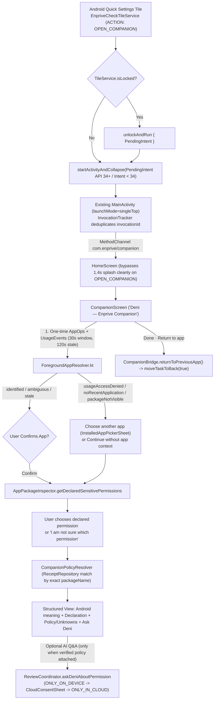

# Quick Settings Companion — Architecture & Integration (`QS-1` to `QS-4`)

## 1. End-to-End Flow Inside Existing Enprive Architecture

Enprive's Quick Settings Companion reuses the single existing `FlutterActivity` (`singleTop`), M3 Expressive tokens (`EnpriveM3ETheme`), unmodified `DeniAnimatedMascot`, `ReviewCoordinator`, `PolicyUrlRetriever`, `CloudConsentSheet`, `InstalledAppPickerSheet`, and `ReceiptRepository`.

## 2. Native Kotlin Components (`android/app/src/main/kotlin/com/example/enprive/`)

1. **[EnpriveCheckTileService.kt](../../android/app/src/main/kotlin/com/example/enprive/EnpriveCheckTileService.kt)** (`TileService`, non-active action mode):
   - Uses `Tile.STATE_INACTIVE` (`Enprive Check` / `Ask Deni`) with monochrome white vector icon [ic_qs_enprive_check.xml](../../android/app/src/main/res/drawable/ic_qs_enprive_check.xml).
   - Implements `onTileAdded`, `onStartListening`, `onStopListening`, `onTileRemoved`, and `onClick`.
   - Executes zero network calls, zero AI inference, and zero background polling inside tile callbacks.
   - Uses `unlockAndRun` when `isLocked == true` before starting `MainActivity`.
   - Uses `startActivityAndCollapse(PendingIntent)` with `PendingIntent.FLAG_UPDATE_CURRENT or PendingIntent.FLAG_IMMUTABLE` on Android 14+ (API 34+), retaining `@Suppress("DEPRECATION") startActivityAndCollapse(Intent)` for Android 8–13 (`minSdk = 26`).

2. **[CompanionContract.kt](../../android/app/src/main/kotlin/com/example/enprive/CompanionContract.kt)**:
   - Explicit action `com.mitechdlin.enprive.action.OPEN_COMPANION` with `INVOCATION_SOURCE`, `INVOCATION_TIMESTAMP_MS`, and UUID `INVOCATION_ID`. Never passes any fabricated package name in intent extras.
   - `InvocationTracker` (synchronized bounded LRU set of max 64 IDs) guarantees repeated delivery or Activity restarts never replay an already-consumed tile tap.
   - `QuickSettingsTileStateStore` persists local tile installation/decline flags so Enprive does not nag users who dismissed `StatusBarManager.requestAddTileService`.
   - Strict package name regex validator (`^[a-zA-Z0-9_]+(\.[a-zA-Z0-9_]+)+$`).

3. **[ForegroundAppResolver.kt](../../android/app/src/main/kotlin/com/example/enprive/ForegroundAppResolver.kt)**:
   - Performs strictly one-time `UsageStatsManager.queryEvents()` lookup when requested on `Dispatchers.IO`.
   - Configurable windows: `DEFAULT_CANDIDATE_WINDOW_MS = 30_000L`, `DEFAULT_STALE_CUTOFF_MS = 120_000L`, `DEFAULT_AMBIGUITY_TIE_WINDOW_MS = 8_000L`.
   - Excludes Enprive's own package (`com.mitechdlin.enprive`, resolved dynamically via `context.packageName`) and filters strictly transient interaction shells (`com.android.systemui`, permission controllers, package installers, resolver, and active home launchers) without discarding legitimate preinstalled user apps (Chrome, Maps, etc.).
   - Distinguishes all 7 explicit resolution statuses (`identified`, `ambiguous`, `stale`, `usageAccessDenied`, `noRecentApplication`, `packageNotVisible`, `resolutionFailed`).

4. **[AppPackageInspector.kt](../../android/app/src/main/kotlin/com/example/enprive/AppPackageInspector.kt)**:
   - Consolidated single PackageManager inspection service shared by both `com.enprive/hybrid_ai` (`listLaunchableApps`, `getAppIcon`, `inspectSelectedApp`) and `com.enprive/companion` (`getDeclaredSensitivePermissions`).
   - Curates meaningful sensitive categories (Location, Camera, Microphone, Contacts, Calendar, Phone, SMS, Photos & Media, Nearby Devices, Notifications, plus `AD_ID` labeled explicitly as `manifestDeclaredOnly`) while omitting install-level noise such as `INTERNET` or `VIBRATE`.

5. **[MainActivity.kt](../../android/app/src/main/kotlin/com/example/enprive/MainActivity.kt)**:
   - Registers MethodChannel `com.enprive/companion` alongside existing `com.enprive/hybrid_ai`.
   - Handles both cold start (`getInitialCompanionInvocation`) and warm `onNewIntent` push (`onCompanionInvocation`).
   - Enforces live `KeyguardManager.isKeyguardLocked` gating inside `checkUsageAccess`, `resolveForegroundApp`, and `getDeclaredSensitivePermissions`.
   - Implements `requestQuickSettingsTile` via `StatusBarManager.requestAddTileService` on API 33+ and `manual_required` on API < 33.

## 3. Flutter / Dart Layers (`lib/`)

- **[companion_bridge.dart](../../lib/services/platform/companion_bridge.dart)**: Typed boundary over `MethodChannel('com.enprive/companion')` returning structured enums and immutable models cleanly.
- **[companion_policy_resolver.dart](../../lib/domain/companion/companion_policy_resolver.dart)**: Matches saved verified `PolicyReviewReceipt` records strictly by confirmed `packageName`, builds evidence-separated `CompanionPermissionExplanation` objects reusing `PermissionComparator.inspectPermissionMentionInPolicy`, surfaces explicit `"We couldn't verify this application's privacy policy yet."` when unavailable, and provides guided `"I'm not sure which permission"` options.
- **[review_coordinator.dart](../../lib/domain/review/review_coordinator.dart)** (`askDeniAboutPermission`): Answers deterministically without cloud calls when no policy is verified; when a verified policy exists, routes Q&A through `askDeniAboutFinding` while stripping `packageName` and excluding permission inventories.
- **[companion_screen.dart](../../lib/screens/companion_screen.dart)**: Calm contextual UI built exclusively on `EnpriveM3ETheme` (`M3EColorScheme`, `EnpriveSurfaceTokens`, `EnpriveSemanticColors`) and unmodified `DeniAnimatedMascot` (`LOD 1` compact `56dp`).
- **[settings_screen.dart](../../lib/screens/settings_screen.dart)**: Adds non-intrusive `Connect Enprive to Quick Settings` onboarding for tile installation, optional Usage Access toggle/revocation instructions, `AppLifecycleState.resumed` auto-refresh, and direct `"Open Deni Companion"` launcher.
- **[main.dart](../../lib/main.dart)**: Prioritizes `OPEN_COMPANION` checks on cold/warm launch, dismisses splash cleanly when launched from Quick Settings, prevents stacked duplicate companion routes, and suppresses auto-onboarding from covering a tile launch.
